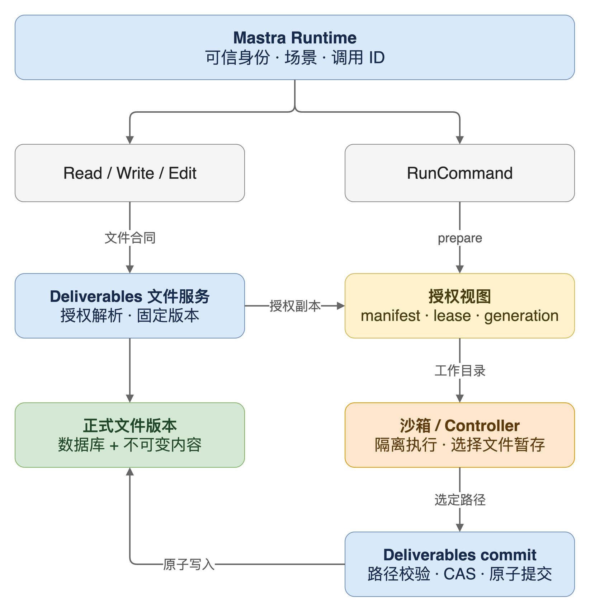

Agent 读到一份 `report.md`，调用脚本改完，再回答用户“已保存”。这句话背后至少有几件事需要核对：它读的是谁的文件、脚本改的是哪一份副本、执行期间正式版本有没有变化，以及结果是否已经进入文件服务。

在 AgentOS 里，文件既有共享与私人归属，又带着场景、版本和交付物关系。把整个 workspace 目录挂给沙箱，会让这些约束绕到文件工具之外；只提供 HTTP 读写，又接不住 Python、Node 和 Office 处理程序需要的本地路径。

我们现在采用的办法是：**由 Deliverables 管理文件事实，Runtime 通过文件合同访问；执行命令时，再把当前获准读取的文件投影成临时视图，结果经显式提交成为文件版本。**

这篇按 2026 年 11 月 4 日工作区内的独立 VFS 实现与 Runtime 对接分支整理，记录文件与执行之间的边界。

## 文件身份、目录和执行副本各有职责

这里的 VFS 是应用层的逻辑文件系统。它负责把文件定位、权限和版本语义统一起来，沙箱里的普通程序仍然使用本地文件 API。实现中没有要求程序认识 Deliverables，也没有通过 FUSE 接管每一次系统调用。

先把几个容易混用的名字拆开：

| 名称 | 表达什么 | 使用方式 |
| --- | --- | --- |
| `fileId` | 文件的稳定身份 | 引用、授权、版本查询都围绕它进行 |
| `logicalPath` | 用户看到的相对路径 | 用来展示和组织目录，同名时需要消歧 |
| `version` | 某个文件的一次内容版本 | 对外是正整数，固定版本读取不会追着最新内容变化 |
| `etag` | 一次读取得到的写入基线 | 编辑已有文件时带回，检测并发变化 |
| `objectBase` | 绑定交付物的业务基线 | 检查对象修订、治理、候选和生命周期是否变化 |
| 物理路径 | 存储或执行时的落盘位置 | 由可信服务推导，不作为模型或浏览器的文件身份 |

私人域和共享域可以各有一份同路径文件。服务遇到这种情况返回 `FILE_PATH_AMBIGUOUS`，调用方需要选择具体的 `fileId`。默认按“私人优先”或“共享优先”选择，会让调用方在不知情的情况下读写另一份文件。

归属也不能靠文件名推断。用户上传按选中的私人或共享目录落位；Agent 新建普通文件默认进入当前用户、当前场景的私人域。Agent 要创建绑定交付物的共享文件，需要提供服务端可验证的目标。已有文件继续沿用自己的归属。

存储层保存不可变内容和数据库中的当前版本指针。共享目录、私人目录以及 OSS 同步都有对应的状态；这些落地结果可以通过任务恢复。Runtime 保留执行缓存、技能和解析中间结果，业务文件的正式写入统一回到 Deliverables。



这张图里有两条入口。`Read`、`Write`、`Edit` 使用文件服务合同；`RunCommand` 需要先准备本地视图。两条入口最终使用同一套文件解析、权限与版本提交规则。

## 授权视图把一次执行能看到的文件固定下来

一次完整读取会先解析文件身份和版本，再读取该固定版本的内容。Runtime 对完整内容读取校验字节数和 SHA-256，避免元信息描述的是一个版本，拿到的内容却来自另一次更新。模型只需要知道逻辑路径或文件 ID。

命令执行需要多一步。Deliverables 根据可信主体、场景和线程准备视图，把允许访问的正式文件复制进去，并记录一份 manifest。每个条目包含文件 ID、逻辑路径、版本基线、`etag`、`objectBase`、校验和，以及是否只读。

视图身份的计算还包含服务主体、Agent 访问上下文、授权范围和显式文件授权。当前实现用身份、manifest 与目录清单计算 `viewId`。同一个用户在另一个线程执行，或者授权集合、文件基线发生变化，都不能直接沿用原来的视图绑定。

运行端合同的核心操作很少，以下路径都位于 workspace 的 `/vfs` 前缀下：

| 操作 | 作用 |
| --- | --- |
| `POST /resolve` | 解析一个已授权的文件及版本元信息 |
| `POST /views` | 准备授权视图，返回租约和文件清单 |
| `POST /views/{viewId}/commit` | 提交指定相对文件路径 |
| `POST /views/{viewId}/release` | 释放当前租约 |

当前源码把视图上限定为 512 个文件、总计 128 MiB，租约为 3600 秒；单文件另受上传大小上限约束。这些是有意设置的资源边界。将来若要支持大型代码仓库，需要重新设计输入准备和增量传输，不能直接把现有上限调大就当作完成。

`file_ids` 可以显式缩小输入集合，也用于处理同路径文件的选择。视图中不会出现整个原始私人目录、blob 仓库或候选内容目录。跨场景读取授权只允许同一 owner 的受选文件进入读取范围，对应条目仍禁止跨场景写回。

视图根目录只供可信 Runtime 绑定挂载。Runtime 收到视图信息后，会依据自己的 PVC 映射重新推导路径，校验合同版本、视图 ID、generation 和有效期。远端返回一个绝对路径，并不足以让 Runtime 把它挂进沙箱。

## 命令退出、暂存成功和版本提交是三个状态

假设 Agent 要从 `input.csv` 生成 `report.xlsx`。执行过程可以按下面的顺序理解：

1. Runtime 准备输入视图和命令需要的技能，将工作目录映射到沙箱里的 `/workspace/work`。
2. 沙箱执行程序。生成的文件先存在执行环境中。
3. 命令成功后，Controller 按 `writeback_paths` 把选中的文件写入暂存视图。
4. Runtime 请求 Deliverables 提交这些路径。
5. Deliverables 校验后创建文件版本，返回文件收据。

因此，退出码为零只说明命令执行成功；Controller 的 writeback 表示文件已暂存；`file_receipt` 才能证明文件服务完成了正式提交。没有请求写回、没有得到完整收据，Agent 就不能据此声称文件已经保存。

提交服务先读取并校验这一批文件，再进入统一写入流程。路径必须是合法的相对路径；存储访问检查目录与链接；打开文件时使用 `O_NOFOLLOW`，并检查普通文件类型、链接数和大小。读取前后还比较文件状态，内容在捕获过程中变化会返回冲突。

已有文件要同时匹配视图准备时的 `etag` 和 `objectBase`。如果人或另一个 Agent 已经修改了正式版本，旧视图不能覆盖它。绑定对象的治理或生命周期发生变化，也需要重新读取基线。这使得“内容没变”与“现在仍允许按原业务状态写入”成为两项独立检查。

多文件写回共用一个数据库事务。一项失败，这一批正式文件版本都不生效。同一批文件若绑定同一个业务对象，后续写入还要接续本事务中已经推进的对象基线，避免第一份文件写成功后，第二份文件被本次操作自己的变化撞成冲突。

这里的原子性指正式数据库状态与版本指针。内容准备可能已经产生不可变 blob，目录物化和 OSS 同步也有各自的持久任务与状态；它们没有被包装成一个跨数据库、文件系统和对象存储的分布式事务。

还有一个产品语义需要单独说明：当前实现中，**文件保存立即推进文件版本，业务属性继续走候选确认。** 收据中的 `fileWriteState` 表示文件是否保存，业务 `writeState`、`candidateId` 表示对象候选状态。拒绝业务候选不会自动撤销已经保存的文件，产品界面与 Agent 回复都需要把这两件事讲清楚。

## warm 沙箱让租约设计落到了目录 inode 上

临时沙箱每次销毁，视图清理相对直接。warm 沙箱会复用依赖、进程和挂载，删除再按原路径创建目录，可能影响已经存在的挂载。

当前实现对视图做了两种处理。

**已正常释放、且视图身份和基线相同**时，复用原 generation。服务保留视图根目录，清空并重新填充目录内部的授权内容。这样 warm Pod 原先的 `subPath` 挂载仍指向同一个目录 inode。仅仅保证路径字符串相同，无法替代这个条件。

**上一次结果未知，租约随后过期**时，创建新的 generation。即使旧 Controller 迟到写回，也只会碰到旧的物理目录，不会污染新命令的输入。

物理布局因此带着两层身份：

```text
<文件根>/.vfs/<viewId>/<generation>/
```

`viewId` 表达授权与文件基线，generation 隔离不同物理执行世代，lease 决定当前命令能否操作这份视图。仍在有效期内的活跃租约会让并发准备返回 `VFS_VIEW_BUSY`。

超时恢复也沿着这条边界处理。Runtime 对视图准备、提交和释放使用由 run 与 tool call 身份派生的幂等键。可以重放的服务调用沿用原键；服务重放前仍检查当前授权和租约。一次成功收据不能在权限收窄后继续充当通行证。

命令已经提交给 Controller、但结果还无法确认时，Runtime 保留租约，并阻止本轮继续对同一输入集合盲目重试。否则第一次命令可能还在运行，第二次就再次发出网络请求或其他外部写入。文件版本幂等只能约束文件服务，不能替任意 shell 命令消除外部副作用。

视图回收采用有界清理：准备新视图时处理一部分过期记录与孤立目录，避开活跃租约和业务目录。执行缓存的清理不承担业务文件删除职责。

## 新旧边界和当前能力一起构成设计约束

新旧文件链路由请求头的值选择：`X-Space-Mode: v2` 进入 Deliverables，`legacy` 使用 Runtime 原来的文件机制。缺失 Header 只作为旧调用的兼容默认值；非法值会被拒绝。这个 Header 选择业务模式，实际访问仍需要认证与授权。

聊天中保留的 V2 URL 是接入协议约定，不能用来判断文件归属。Runtime 为新版维护独立的远端 workspace 关联和文件根；旧文件不自动迁移，也不会在新版读取失败时扫描旧目录兜底。

这个约束会减少一些“尽量成功”的机会。例如 Deliverables 不可用时，即使 Runtime 本地还有相似路径，也必须返回明确失败。否则同一 `Read` 在服务恢复前后可能读到两套数据，用户甚至无法判断刚才改的是哪一个文件域。

执行数据也有自己的边界。技能包、工具结果和 Office 解析缓存可以通过受控方式进入命令环境；它们不会因为出现在某个磁盘目录里，就自动变成业务交付物。需要长期保存的输出，仍然要经过文件提交。

这套实现目前偏向有界文档处理：按授权准备有限输入，执行后提交明确选中的文件。它没有把沙箱变成一个完整的远程 POSIX 文件系统；命令中的删除也不会自动写回正式文件，`writeback_paths` 选择的是具体文件。大型工程、持续增量同步和广泛的文件系统语义，都需要额外设计。

源码中的回归用例覆盖了版本冲突、多文件失败回滚、路径与符号链接拒绝、跨场景只读、租约过期换代、重放重新鉴权，以及 warm 视图目录 inode 保持。它们检验代码层的行为约束；实际部署还需要单独核对共享卷映射、运行身份、Controller 和 OSS 行为。

<details>
<summary>对应实现与回归用例</summary>

以下路径相对各自仓库根目录。Runtime 部分核对了 `hotfix/vfs-command-lifecycle-261030` 对接分支，Deliverables 部分核对了当前工作区源码。

| 仓库 | 文件 | 关注点 |
| --- | --- | --- |
| `agentos_deliverables` | `src/deliverables-vfs.ts` | 统一授权解析、读取与写入入口 |
| `agentos_deliverables` | `src/file-vfs-views.ts` | manifest、租约、generation、原子提交与清理 |
| `agentos_deliverables` | `src/file-storage.ts` | 不可变内容、路径校验与目录物化 |
| `agentos_deliverables` | `src/file-http-auth.ts` | 幂等重放时重新授权 |
| `agentos_deliverables` | `test/deliverables-vfs.integration.test.ts` | 冲突、隔离、inode 与业务候选行为 |
| `agentos_agent_deploy` | `backend/src/services/deliverables-vfs.ts` | HTTP 适配、固定版本校验与挂载路径推导 |
| `agentos_agent_deploy` | `backend/src/sandbox/run-command-tool.ts` | 执行、暂存、提交和未知结果恢复 |
| `agentos_agent_deploy` | `backend/src/services/deliverables-workspace-service.ts` | 新旧 workspace 的独立关联 |

</details>

我会把“Agent 已保存文件”的判断固定在提交收据上，再分别展示同步进度和业务确认状态。只有这几个状态能被逐项核对，用户才知道下一步该下载文件、等待同步，还是处理待确认的业务变更。
