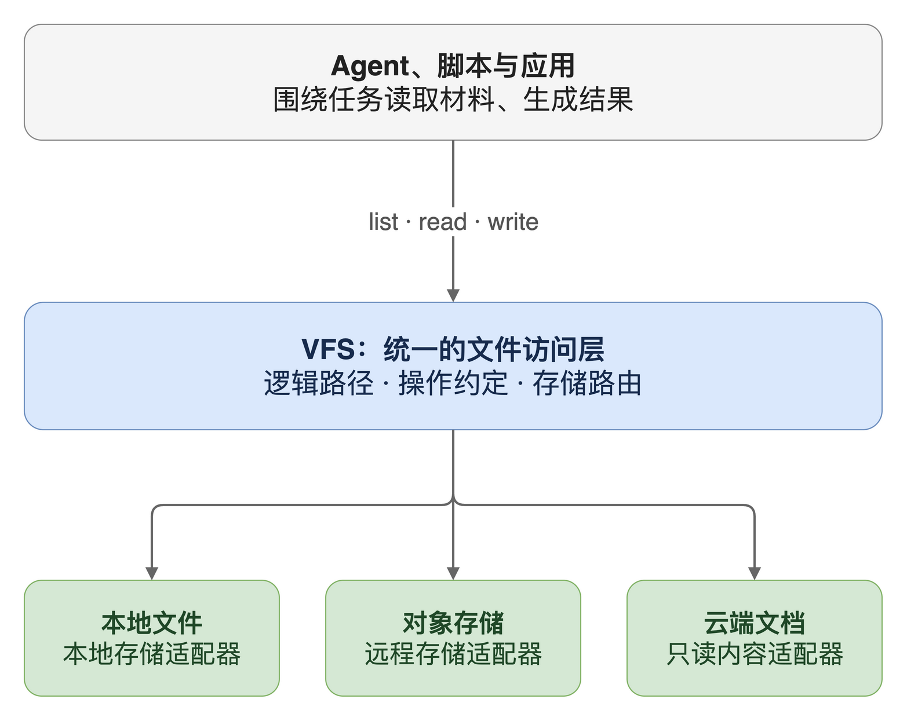

一个 AI 助手接到任务：读取销售表格，结合定价说明，生成分析报告。表格来自上传接口，说明保存在云端文档里，计算程序却只接受本地文件路径。任务结束后，报告还要能被用户重新打开。

把两份材料下载到工作目录，可以完成这一次计算。任务换一个执行环境，路径可能无法使用；材料更新了版本，同一个路径又可能读到不同内容。另一个工具继续处理报告时，还需要知道这份文件是否已经可靠保存。

这里要解决的问题是：**当 Agent 跨存储、跨工具处理文件时，怎样让文件的定位与读写约定保持一致，而不要求每个工具了解整套存储系统？**

VFS（Virtual File System，虚拟文件系统）提供了一种组织方式：上层使用统一的文件接口，下层负责将操作落实到具体资源。对于能调用工具、执行任务的 AI 助手，也就是 Agent，这层接口可以减少工具之间的存储耦合。它是否值得引入，取决于这种耦合是否已经成为实际问题。

## 直接传路径，依赖的是一组容易变化的条件

本地路径能正常工作，是因为调用方与文件位于约定好的环境中。`/work/sales.csv` 对当前进程有意义，换到另一台执行机器上，同一个字符串可能找不到文件，也可能指向另一份内容。

远程地址也只能解决一部分问题。它能说明去哪里取内容，却未必说明这次任务应该读取哪个版本、调用方是否允许修改，以及地址失效后如何继续引用文件。

常见的接入方式各有用途：

| 做法 | 能解决什么 | 仍需调用方承担什么 |
| --- | --- | --- |
| 工具直接调用存储 SDK | 使用后端提供的完整能力 | 理解不同的地址、认证与操作语义 |
| 先下载到工作目录 | 让现有脚本获得本地输入 | 维护副本、命名、访问范围和输出保存规则 |
| 每种来源提供独立工具 | 快速接入不同资源 | 在工具之间转换定位方式与使用约定 |

如果每个工具都单独处理这些问题，一次存储调整就可能同时牵动读取、解析、搜索和导出。即使它们都能读写字节，也不代表它们对“同一份文件”和“保存完成”有相同理解。

因此，增加一层 VFS 的理由，是把反复出现的文件访问规则从工具中提取出来，让任务和存储位置能够分别变化。工具只依赖共同约定，具体来源由文件访问层处理。

## VFS 稳定的是文件接口，底层实现仍然不同

在操作系统中，Linux VFS 为用户程序提供共同的文件系统接口，并把具体操作交给相应文件系统实现。[Linux 内核文档][1]说明了这种接口与实现分离的关系。

应用可以采用相同的抽象方式。Python 的 `fsspec` 提供共同的文件操作接口，底层可以是本地文件、远程存储或其他能提供文件对象的实现。[fsspec 使用文档][2]给出了这类适配的具体形式。

对于一个 Agent 任务，可以进一步把资源组织成任务内的逻辑路径：

```text
/inputs/sales.csv        本次选中的销售数据
/reference/pricing.md    本次获准读取的定价说明
/outputs/report.txt      本次任务的输出位置
```

工具围绕这些名字工作。VFS 负责把名字解析到实际资源，再选择存储适配器执行读写。底层从本地目录换成远程存储时，只要这份约定仍成立，上层工具就可以继续使用。



这里讨论的是应用层 VFS。它可以先是一组普通接口；只有使用者需要本地目录或系统调用时，才需要缓存、挂载或执行目录等配套机制。

统一接口也需要承认实现差异。一个只读文档源可以提供读取能力，却不能因为接口里存在 `write` 方法就支持写入。哪些操作可用、成功意味着什么，都属于接口约定的一部分。

## 三个设计，让接口承接文件访问规则

### 先绑定资源，再让路径成为任务里的名字

逻辑路径的价值，在于它可以保持工具输入稳定。要做到这一点，系统必须先决定这个名字在当前任务里代表什么。

如果只是把远程地址换成更短的字符串，却没有明确绑定，多个来源中的同名文件仍然会冲突。仅凭路径字符串相同，也不能断定两个用户的 `/inputs/sales.csv` 指向同一份资源。

一种最小实现是为任务维护绑定表：

| 逻辑路径 | 资源来源 | 允许的操作 |
| --- | --- | --- |
| `/inputs/sales.csv` | 当前任务选中的附件 | 读取 |
| `/reference/pricing.md` | 当前任务选中的文档内容 | 读取 |
| `/outputs/report.txt` | 当前任务的输出存储 | 写入、读取 |

读取时，先在当前任务的绑定表里解析名字，再调用对应适配器。哪些资源可以绑定，由可信程序根据用户权限决定；模型不能通过提交一个底层地址扩大绑定范围。

这样，不同工具能够引用同一份任务输入，存储位置变化也主要由绑定层处理。若文件还需要跨任务长期引用，可以另外分配稳定资源 ID；若任务必须复现某次输入，还需要固定版本。一个逻辑路径本身并不自动提供这些能力。

### 共同接口要约定能力和结果，不能只统一函数名

函数名相同，只能降低调用形式的差异。调用方还需要知道：一次读取是否完整、一次写入是否已经持久保存、某种操作是否被支持。

例如，解析工具假定所有文件都可以修改，它就可能对只读文档发出写入。`fsspec` 的使用文档也明确指出，部分实现不支持所有操作，例如 HTTP 文件系统只读。[2]

应用可以在资源绑定中记录允许的操作，在执行前检查；对于后端本身不支持的能力，返回明确的不支持结果。写入结果则需要区分已接收、处理中、已保存等系统实际存在的状态，不能把它们都折叠成一个含糊的“成功”。

这使工具能够依据相同约定处理结果。Agent 可以据保存结果回复用户，导出工具也能判断是否已经存在可供下载的文件。

这层约定只对经过接口的访问有效。如果代码仍然持有能直接操作底层存储的对象或凭据，它就可能绕开接口检查。后面的实验会专门验证这个边界。

### 需要本地路径时，给脚本准备执行表示

许多程序可以接受文件对象，这时适配器可以直接提供读取接口。另一些程序只接受本地路径，就需要把选定资源准备成执行目录中的文件。文件接口统一后，仍然需要处理这种调用形式的差异。

把整个存储目录挂给脚本虽然方便，却会把与任务无关的资源一并暴露；把所有文件提前复制过来，又可能带来无用的数据传输和过期副本。

更有针对性的做法是：按任务绑定准备输入，把中间数据留在执行环境中，再通过文件访问层保存选中的输出。

| 阶段 | 需要明确的约定 |
| --- | --- |
| 准备输入 | 选择哪些资源，是否固定版本，哪些允许修改 |
| 执行计算 | 本地路径如何对应任务文件，中间结果存放在哪里 |
| 保存输出 | 哪些文件需要保留，何时算保存完成，失败如何反馈 |

如果任务执行期间正式文件可能被其他人修改，可以使用原子的条件写入：只有当前版本仍匹配读取基线才覆盖，否则返回冲突。检查和写入必须成为一个受保护的操作；先查询版本，再普通覆盖，仍然存在竞争窗口。这是按并发需求增加的写入规则，后端和应用必须共同实现。

这种执行表示让现有脚本继续使用普通文件操作，同时把长期文件的保存留在共同入口上。脚本的进程隔离、凭据限制和本地目录权限仍需由执行环境保证。

## 一个最小实验：换存储能复用，绕开接口会怎样

为了检验上面的作用，我做了一个只使用合成数据的例子。它使用 Python `3.9.6` 和 `fsspec 2025.10.0`，分别在本地文件系统与内存文件系统上执行相同的报告函数。

两次执行只替换任务绑定中的后端对象和实际路径，工具函数保持不变：

```python
def build_report(files):
    rows = csv.DictReader(
        io.StringIO(files.read("/inputs/sales.csv").decode("utf-8"))
    )
    total = sum((Decimal(row["amount"]) for row in rows), Decimal("0"))
    files.write("/outputs/report.txt", f"total={total:.2f}\n".encode("utf-8"))
```

示例中的 `TaskFiles` 只做两件事：按逻辑路径查找绑定，以及写入前检查该路径是否允许写。实际字节操作交给 `fsspec` 的后端对象。

我还加入了一个负对照：在接口拒绝修改输入之后，直接使用底层存储对象修改同一个文件。实测结果如下，完整[示例代码](vfs-contract-demo.py)和[运行结果](vfs-contract-results.json)可以下载复现。

| 检查项 | 本地文件系统 | 内存文件系统 | 支持的结论 |
| --- | --- | --- | --- |
| 同一工具函数生成报告 | `total=30.00` | `total=30.00` | 这两种后端可以通过绑定复用同一读写流程 |
| 通过接口修改只读输入 | 被拒绝 | 被拒绝 | 入口检查能约束经过它的操作 |
| 读取未绑定的逻辑路径 | 被拒绝 | 被拒绝 | 工具可以只在显式绑定的名字中定位文件 |
| 直接使用底层对象修改输入 | 修改成功 | 修改成功 | 入口检查不能约束绕过它的访问 |

这组结果说明，在这个最小实现中，工具代码可以与底层位置解耦；任务绑定也能集中表达接口内的访问规则。后一项检查同时说明，单独增加一个包装类不能形成执行隔离。

它没有验证真实对象存储、网络故障、并发写入、版本快照或跨进程权限，也没有测量性能。这些结果不能用来推断 Agent 的整体任务成功率。将相应能力写进正式接口之前，还需要针对后端和失败场景分别验证。

<details>
<summary>运行这个例子</summary>

下载 `vfs-contract-demo.py` 后，在类 Unix shell 中执行：

```bash
python3 -m venv .venv
. .venv/bin/activate
python -m pip install fsspec==2025.10.0
python vfs-contract-demo.py
```

程序只操作临时目录和当前进程的内存文件，运行结果会打印到标准输出。示例中的访问检查用于解释机制，不是可直接部署的授权或沙箱实现。

</details>

## 适用边界决定 VFS 应该做到多大

如果系统只有一个本地目录和少量工具，直接使用现有文件接口可能已经够用。引入 VFS 会增加资源解析、状态管理和故障定位的成本，只有它减少的重复规则与耦合值得这些成本时，抽象才有意义。

当多个工具开始重复处理下载、命名、访问范围和保存结果时，这层接口更有价值。它可以先覆盖共同需要的列举、读取、写入与元信息，再按实际任务增加版本、缓存或批量操作。

能力越多，越需要说明它们的前提。缓存要处理内容是否过期；固定输入版本需要后端保留相应内容；写入重试要考虑上一次结果是否已生效。VFS 可以承接这些约定，却无法凭空让后端具备相应能力。

事务也是如此。`fsspec` 的事务说明将具体实现与后端绑定，并指出跨多个实例同步事务仍是另外的问题。[事务文档][3]不能作为跨存储原子性的承诺；应用仍需选择自己能够验证的提交范围。

设计时，我会先写下三条约定：

- 一个逻辑路径在什么任务范围内代表哪份资源；
- 这份资源允许哪些操作，失败和不支持如何表达；
- 输出何时算保存完成，执行副本如何与长期文件区分。

再用真实使用者和失败场景检验这些约定：换一个后端，工具是否仍能工作；换一种执行方式，访问规则是否仍然生效；写入发生冲突，调用方是否知道下一步该做什么。接口的范围应由这些答案决定。

<details>
<summary>参考资料</summary>

Sources:

[1] [Linux VFS：统一接口与具体文件系统](https://docs.kernel.org/filesystems/vfs.html)

[2] [fsspec Usage：文件系统适配与能力差异](https://filesystem-spec.readthedocs.io/en/latest/usage.html)

[3] [fsspec Features：缓存与事务的边界](https://filesystem-spec.readthedocs.io/en/latest/features.html)

[1]: https://docs.kernel.org/filesystems/vfs.html
[2]: https://filesystem-spec.readthedocs.io/en/latest/usage.html
[3]: https://filesystem-spec.readthedocs.io/en/latest/features.html

</details>
