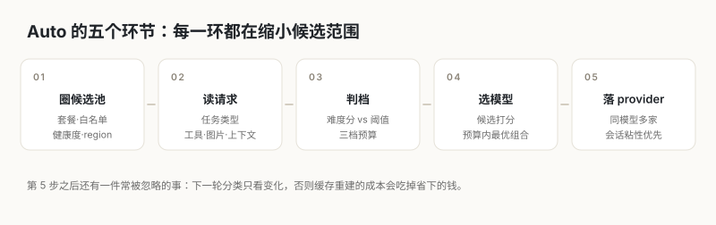
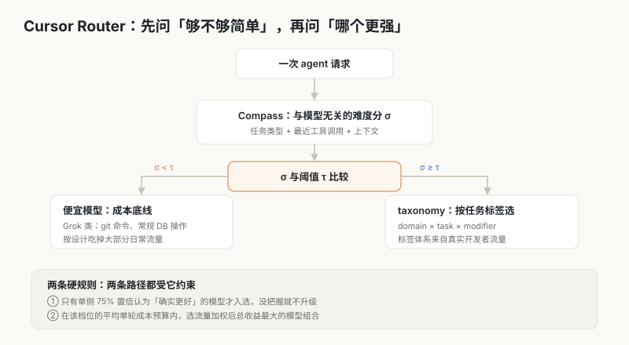

前两天在 Studio 里看模型下拉框，Auto 那一行就在最上面。你点它，等于把「这一轮谁来回」交给一个看不见的分类器。这件事所有产品都在做，但没人把它写清楚——官方博客给的是结论和曲线，论坛里给的是「为什么我的 Auto 永远只选同一个模型」。

我想搞清楚的是：**那次判断到底在什么时刻、用什么信号、按什么规则做出来的**。顺带一个更实际的问题：如果自己搭这一层，现成的网关能给你多少，缺的那块到底是什么。

## 60% 的人只选一个模型，这是路由存在的理由

Cursor 在自己博客里给了个数：约 60% 的开发者日常只挑一个模型当主力。这个数解释了一切——routine 的活（改一行 CSS、跑个 git 命令、解释一段报错）和硬活（跨文件重构、查一个只在生产复现的 bug）按同一个价格结算，账单的增长速度远超产出质量的增长。

动机有四层，越往后越不显眼：

- **成本结构**。便宜模型和前沿模型的价格差是数量级的，而日常工作中大部分请求落在便宜那侧。
- **模型迭代速度**。新产品一个月上三个模型，产品方不想每上一次就教育用户一次「这次该选谁」。
- **平台才有的数据**。单一用户看不到「这类任务上，几万人用 A 模型之后接下来干了什么」；平台看得到。这是路由能不能做准的根本差距。
- **缓存反向约束**。换模型会让 prompt cache 作废，省下的钱可能还不够重建缓存的。所以做路由不是「切得越勤越好」，这条约束直接决定了后面所有产品的粘性设计。

## 一条五步流水线，五家都是同一套骨架

把 Cursor、Copilot、Windsurf、OpenRouter、ChatGPT 的实现摊开，结构几乎重合。差别全在第 2、3 步怎么打分，以及第 5 步怎么收尾。



*图 1：每一环都在把候选范围缩小，到第 4 步其实只剩一个决定。*

| 环节 | 要回答的问题 | 各家差异 |
| --- | --- | --- |
| 圈候选池 | 这个账号/团队/地区能用哪些模型？哪些现在不健康？ | 差异最大：Cursor 要求开 Grok 才能工作，OpenRouter 走用户自己的 guardrail 和 BYOK |
| 读请求 | 这一轮是什么活、有多难、要不要工具、要不要看图 | Cursor 用学出来的标签体系，LiteLLM 默认用关键词权重 |
| 判档 | 够不够简单？值不值得上贵的？ | 有的只有一档阈值，有的三档预算 |
| 选模型 | 同类工作里，谁的实际表现最好？ | Cursor 有 75% 置信门槛，OpenRouter 直接看社区花费份额 |
| 落 provider + 粘性 | 同一模型多家供应商，选谁？要不要沿用上一轮的？ | 全部都有 sticky 机制，只是叫法不同 |

一个容易忽略的细节在第 5 步后面：下一轮的分类器不该从头判一遍，而应该只看「任务有没有变」。否则每轮重判、每轮换模型，缓存一直在重建，省的钱全还回去了。这五家都处理了这件事，做法不同——Cursor 和 OpenRouter 把它写进路由算法，LiteLLM 用一个开关暴露给使用者。

## Cursor Router：把决策拆成「够不够简单」和「哪个更强」

Cursor 是这几家里讲得最细的。它的 Auto 背后是 Cursor Router，2026 年 7 月上线，8 月补了一篇讲算法的博客。

核心是把一次决策拆成两段，而不是一次性做多分类：



*图 2：第一段只做二分类，第二段才在候选里挑——这是它比「一个分类器直接输出模型名」更稳的地方。*

第一段叫 **Compass**，是一个与具体模型无关的复杂度预测器。它给这一轮打一个难度分 σ，和阈值 τ 比：

- σ < τ：直接走便宜模型。Cursor 拿 Grok 当这个成本底线，所以企业版想用 Router，必须允许 Grok——它不是可选优化，是路由的底座。
- σ ≥ τ：进入第二段，用一套从真实开发者流量里学出来的标签体系（taxonomy）判断「这类活谁最擅长」。

标签体系有三个维度，这个划分比「代码/非代码」细得多：

- **Domains**：活发生在哪——后端、数据库 schema、前端。
- **Tasks**：要做什么——修 bug、跑命令、写测试。
- **Modifiers**：跨维度的特征，会改变最优选择——有界的小改动、产品问题、视觉密集的改动。

他们顺手公布了观察到的分工：Grok 在 git 命令和常规数据库操作上性价比最高；Sol 强在规划和代码库理解；Opus 强在执行密集的活（devops、查询、性能优化）；Fable 在调试和视觉实现上值得多付钱。这类结论不可能从 benchmark 里读出来，只能从「用户接下来干了什么」里读出来。

第二段的选择被两条硬规则卡住，这是整篇博客里最值得抄的部分：

**规则一：只有确定更好才升级。** 一个候选模型要入选，得在「该任务标签下」单侧 75% 置信地优于便宜模型。换算成人话：没有 75% 的把握认为这点提升是真的，就不升。这条规则专门压抖动——否则分类器在边界上反复横跳，用户体感是「有时很聪明有时很蠢」。

**规则二：预算内选最优组合。** 通过门槛的候选里，优化器挑一个按流量加权、期望收益最大、同时平均单轮成本不超该档预算的组合。于是三个模式其实就是三个参数点：`Cost` 沿用旧 Auto 的逻辑只优化 token 花费；`Balance` 把更多流量留在便宜路径、给任务路由更小的预算；`Intelligence` 给任务路由更大空间。

训练侧的两个做法比模型结构更重要：

- **数据来自线上**。60 万+ 真实请求，保留真实的开发者任务混合比例、每轮上下文、以及切换模型带来的影响。
- **reward 是用户行为，不是 benchmark**。他们从「用户下一步做什么」推断表现：接着做下一个任务算强正信号，回头纠正 agent 算强负信号（内部叫 AFC）。benchmark 分数和「这轮到底省没省事」经常对不上，这条替代掉了对 benchmark 的依赖。

还有一处工程上容易被忽略的自律：它是 **cache-aware** 的，训练和评估都把路由造成的 cache miss 成本算了进去。换句话说，它报的省钱数字已经付过这笔账了。

企业侧的默认设置更能说明产品判断：底层模型名默认隐藏，官方理由是「让人按结果评价，而不是按模型名」。他们清楚一旦露出名字，用户就会开始按品牌而非结果做判断，路由的意义会被抵消。

结果是：`Intelligence` 达到高于 Fable 的满意度、成本低 68%；`Balance` 超过 Opus 4.8、成本低 41%；上线前在数百万请求上做 A/B，报 60% 的成本节省。

## 同一个骨架，四家不同的取舍

### Copilot：把「模型还活着」当成一等信号

Copilot 的自动选择明确说自己是两套系统叠加：一套跟踪实时系统健康和可用性，一套评估任务复杂度，合起来决定给谁。这一点其他家很少讲——路由不只是选「谁更聪明」，也是选「谁现在还能干活」。

它有一句工程上很诚实的设计说明：**只在自然的缓存边界、以及对话复杂度发生大跳变时才换模型**。为了不确定的质量收益去付确定的缓存钱，是亏的。语言无关性（判断依据是意图不是提问语言）也被单列成了一条特性，说明这件事在实践中真会出错。

三档（Efficiency / Balance / Intelligence）不改变可用模型集合，只改变「偏好怎么选」。同档之内仍然逐 prompt 判断，所以 Intelligence 档里的简单问题照样可能给小模型。

### Windsurf：把不确定性留在自己这边

Windsurf 的 Adaptive 机制描述得最少（分析 prompt、简单的走快模型），但产品化最彻底：**用户侧按固定 per-token 费率计量，不管底层路由到谁**。意思是路由省下的钱和风险都由厂商承担，用户账单里没有「这次为什么贵了」这个问题。

企业侧才回到按实际模型计量（ACU 或 credit）。文档里还直接建议用户「尽量待在同一个模型上以利用 prompt caching，Adaptive 在路由时会考虑这一点」——把内部约束说给用户听，让用户帮着降低路由成本。

### OpenRouter：从「我猜谁更强」改成「看大家把钱花在哪」

OpenRouter 的 Auto 值得单独说，因为它换过一次世界观。

现在的机制文档写得很具体：先用一个快速的决策模型，一次调用给请求打十一个维度的分（任务类型、任务是否刚变化、难度、是否在意速度、要不要视觉、要不要代码库知识、是否需要更大模型或更多思考……），再由策略结合实时价格、缓存状态、benchmark 表现和用户选的 `cost_tier`，**同时决定模型和 reasoning effort**。然后照常走 provider 路由，最后把「这个模型是不是在挣扎」「上下文已经缓存了多少」带进下一轮。

更早那次改版（2026 年 8 月）思路完全不同：不预测哪家模型强，而是把 prompt 归到约 30 种细粒度任务类型，然后查**过去 7 天社区在同类任务上真实花钱的份额**，据此排序。理由是他们一周看到 55T token 的花费，几十万开发者的集体选择比任何 benchmark 都更贴近真实。新模型一上线就被自动吸收进排名，不需要重新训练。

两代并存的结果是：路由可以老实地把「为什么选它」暴露出来（`X-OpenRouter-Metadata` 头能看到候选、成本、理由），这在所有产品里是罕见的——多数产品故意不让你看。

### ChatGPT：路由藏在模型内部

从 GPT-5 开始，这件事不是下拉框选项，而是系统定义的一部分：一个统一系统里包含快模型、思考模型和**一个实时路由器**，按对话类型、复杂度、工具需求、以及显式意图（你说「think hard about this」就强制上思考模型）决定走哪条。

它和上面几家最大的区别是训练方式：路由器**持续用真实信号训练**——用户中途换模型、对回答的偏好票、测得的正确率。额度用完后每个模型退到 mini 版本继续服务。这是「模型内路由」，你在 API 里看不到，也没法配。

| 产品 | 决策粒度 | 核心信号 | 档位 | 能否看到底层模型 |
| --- | --- | --- | --- | --- |
| Cursor Router | 每个 agent 请求 | 复杂度预测器 + 三维任务标签 + 用户后续行为 | Cost / Balance / Intelligence | 可配，默认隐藏 |
| Copilot | 每个 prompt | 实时健康度 + 复杂度检测 | Efficiency / Balance / Intelligence | 部分可见 |
| Windsurf Adaptive | 每个请求 | prompt 分析 + 缓存状态 | 用户侧固定费率，不感知 | 不感知 |
| OpenRouter Auto | 每个请求（含 reasoning effort） | 11 维打分或社区 7 天花费份额 | low 到 max | 可见，可开 metadata |
| ChatGPT | 每轮（模型内部） | 对话类型/复杂度/工具/显式意图 | 额度 + 手动切 | 部分可见 |

## 这些数字该怎么读

上面全是厂商自报的数字，直接采信会读错。

**第一，满意度不等于正确率。** Cursor 的 reward 是 AFC——用户有没有回头纠正。一个没被纠正但也没真正解决问题的回答，会被算成正信号。「用户被打断的次数」是个有用的代理指标，但它测的是「有没有让人烦」，不是「对不对」。

**第二，几个百分比不同源。** 60%、68%、41% 分别对的是不同基线：60% 是线上 A/B 相对前沿模型质量、68% 是相对 Fable 的满意度、41% 是相对 Opus 4.8。把它们拼成一句「省了 60%」是错的读法。要看的是同一篇博客里的对照组。

**第三，换模型有隐藏账单。** Cursor 和 OpenRouter 都明确说自己的省钱数字含 cache miss 成本，正因为大部分不这么算的宣称都虚高。LiteLLM 也发过一篇对比，说路由比「只做缓存」再省 37% 到 69%——但那是他们自己流量上的自测，换一套工作负载未必成立。

**第四，候选池决定上限，而池子的构成不完全是技术决策。** Cursor 官方说屏蔽太多模型会降低路由质量、甚至让路由失效；论坛上又有不少「Auto 永远选同一个模型」的观测。两件事拼起来说明：路由在池子小时会退化成「没得选」，而这个池子同时受商业关系影响。官方不公开完整算法，外界没法证实或证伪偏差，这条只能当风险记着。

**第五，同一个 router 在不同档位的上限差得很远。** OpenRouter 公布的对照表里，代码问答那一项默认档 30.4%、最高档 60.7%——同一套路由，两倍差距。这说明「路由能省多少」这个问题没有统一答案，它和你的档位、任务分布绑在一起。

## 自己搭：LiteLLM 已经走到哪一步

如果手上有 LiteLLM 网关，先说清两个容易混淆的层：

- `routing_strategy`（`simple-shuffle`、`least-busy`、`latency-based-routing`、`cost-based-routing` 等）是**组内负载均衡**：同一个 `model_name` 挂了多个 deployment，选哪个。它不判断任务难度，不是 Auto。
- `auto_router/*` 是**子路由**：在名字被解析之前，先决定这次该找哪个模型组。这才是 Auto 那一层。

用起来就是在 `model_list` 里造一个虚拟模型，客户端只认这个名字：

```yaml
- model_name: auto
  litellm_params:
    model: auto_router/complexity_router
    complexity_router_config:
      tiers:
        SIMPLE:    gpt-6-luna
        MEDIUM:    gpt-6.1-sol
        COMPLEX:   claude-sonnet-5
        REASONING: claude-opus-5
      session_affinity: true
      classification_mode: user_turn
    complexity_router_default_model: gpt-6.1-sol
```

默认分类器是本地启发式，零 API 调用、亚毫秒级，七个维度加权求和映射到四个档：长度 0.10、代码关键词 0.30、推理标记 0.25、技术术语 0.25、简单指示词 0.05、多步模式 0.03、问号数量 0.02；边界 0.15 / 0.35 / 0.60。另有一条硬编码：两个以上推理标记直接判 `REASONING`，不看分数。

跟 Cursor 比，它已经具备的机制比预期齐：

- **会话粘性**：`session_affinity` 按 `session_id` 钉住首轮模型，默认 TTL 一小时。
- **不重复判**：`classification_mode: user_turn` 只在新的用户诉求上跑分类器，续轮沿用。
- **放不下就升档**：`enable_context_window_escalation`，prompt 超窗口比例就上一档。
- **看不见图就升档**：`modality_routing`，图片请求跳过声明为纯文本的 tier。
- **卡住就升档**：检测到在重试循环里给一档提升。
- **可解释**：每个决策带 `cause=`（scorer / literal / semantic / session_pin / LLM / plugin），`return_raw_model_name` 让响应的 `model` 字段回真实模型。
- **可预演**：`POST /auto_router/test_routing` 只分类不下发。

分类器可以换：`classifier_type: llm` 让一个小模型用结构化输出判档（超时 2000ms，失败回落启发式）、`jev` 走 TypeSafe 的一次 Choice 题、`custom` 挂自己的 Python 插件——这是接自家信号的口子。还有关键词规则跑在打分之前，可开语义匹配。

还有两个子路由值得知道：`quality_router` 把复杂度映射到质量档、再按模型声明的偏好匹配；`adaptive_router` 是 bandit（Thompson 采样），用 `model_info.adaptive_router_preferences`（`quality_tier` 1/2/3、`strengths`）加 `weights: {quality, cost}`，从真实响应里学哪类请求哪个模型好，需要 Postgres，否则重启就忘。

授权要看清：文档说 v1 启发式和内置 OSS 分类不需要 license，v2 链（heuristic v2 / LLM judge）走网关显示的 v2 额度；整块在文档里标着 beta、`[Add-on]`。以自己实例的 View limits 为准，别照文档猜。

**缺的两块，恰恰是最值钱的两块**：一是真实的 reward 信号（你没法让它从「用户有没有回头纠正」里学），二是升级的显著性门槛（它靠阈值加粘性抑制抖动，没有「多少把握才算更好」这一步）。这两块只能在自己的会话数据里做。

## 一条两周能走完的路径

按投入从小到大，三步走，每步都能单独停：

**第一步（半天，零代码）**。网关加一个 `auto` 虚拟模型，四档映射到已经在用的模型，打开 `session_affinity` 和 `classification_mode: user_turn`。前端下拉框加一项 Auto，值就是 `auto`。先只在一个内部 workspace 开，别全量。

**第二步（一周）**。用 `test_routing` 抽一批真实 prompt 看档位分布——如果 90% 都判成复杂，说明阈值和你的任务分布不匹配，此时省钱是零。然后换 `classifier_type: llm` 做影子对比。指标别只看单价，看两个：每完成一个任务的成本、同一会话内用户是否重述或纠正。

**第三步（一个月）**。把会话事件流变成 reward（你们的 run 记录本来就有「这次之后用户干了什么」），用它校准阈值，或者用 `classifier_type: custom` 把判定塞回网关。到这一步才有资格谈「学出来的路由」。

顺序不能反。先接 LLM judge 再想指标，通常会得到一个很贵、看起来很聪明、实际没人验证准确率的分类器。

## 什么时候不该做 Auto

四种情况，做之前先排除：

- **合规或审计要求固定模型**。路由等于把「这次谁答的」变成运行时随机变量，有些行业不接受。
- **候选池太小**。两条便宜模型之间路由，省的是零头，坏的是可预测性。
- **延迟敏感**。启发式是亚毫秒，LLM judge 是额外一跳；对话式产品里 300ms 的额外首字延迟很贵。
- **单模型已经够用**。把小任务分给弱模型，很多时候只是把返工成本挪了个位置——这类损失不会出现在账单上，只会出现在人的耐心上。

## 三条能搬走的结论

**一、reward 用真实行为，别用 benchmark。** Cursor 用「有没有回头纠正」，OpenRouter 用「大家真金白银花在哪」，ChatGPT 用「用户有没有中途换模型」。三者共享一个判断：benchmark 和「这轮省没省事」不是同一个量。

**二、决策要拆两段，且升级要有门槛。** 先做一个二分类（够不够简单，阈值好调好解释），再做「哪个更好」并加显著性门槛。一次性多分类输出模型名看起来很优雅，实际会在边界上抖。

**三、换模型是一笔账，不是一次优化。** 缓存重建、体感不一致、用户开始按品牌判断，都是成本。所以成熟方案的默认动作都是「先别换」，只在任务变了或明显不行时才换。

如果手上已经有网关，最省事的验证方式是：挑一条低风险的链路，开一个档，跑一周，只盯「每完成一个任务的成本」这一个数。这个数降了再谈扩张；没降，说明你的流量分布根本不长那样，任何档位设计都救不回来。

---

主要来源：[Cursor Router 文档](https://cursor.com/docs/cursor-router)、[How Cursor Router chooses the right model](https://cursor.com/blog/how-cursor-router-works)、[Introducing Cursor Router](https://cursor.com/blog/router)；[GitHub Copilot auto model selection](https://docs.github.com/en/copilot/concepts/models/auto-model-selection)；[Windsurf Adaptive](https://docs.windsurf.com/windsurf/adaptive)；[OpenRouter Auto Router](https://openrouter.ai/docs/guides/routing/routers/auto-router)、[Model Routing Powered by Wisdom of the Market](https://openrouter.ai/blog/announcements/introducing-the-new-auto-router/)；[GPT-5 System Card](https://openai.com/index/gpt-5-system-card/)；[LiteLLM Auto Routing](https://docs.litellm.ai/docs/proxy/auto_routing)、[Strategies and sub-routers](https://docs.litellm.ai/docs/router/learn/strategies)、[Adaptive Router](https://docs.litellm.ai/docs/adaptive_router)。