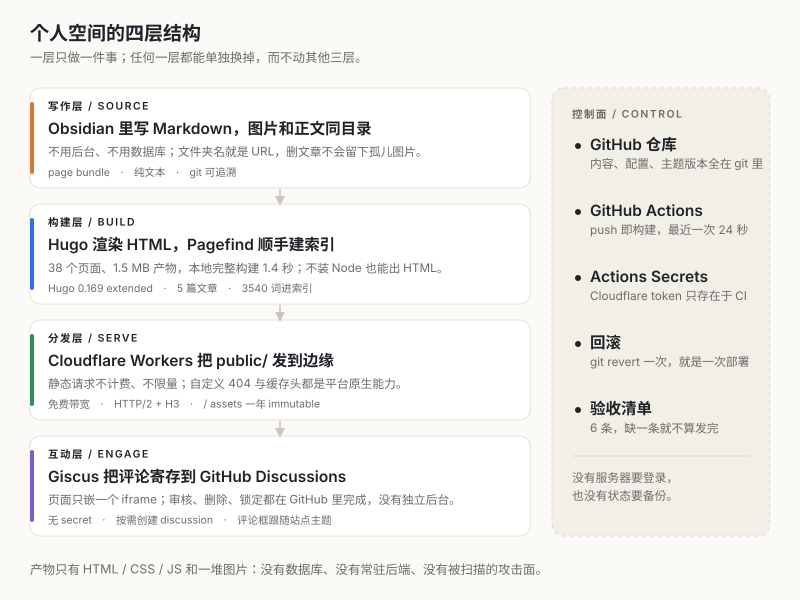
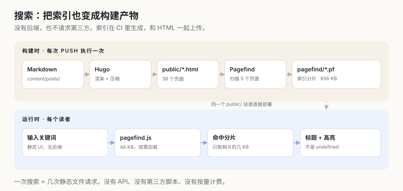
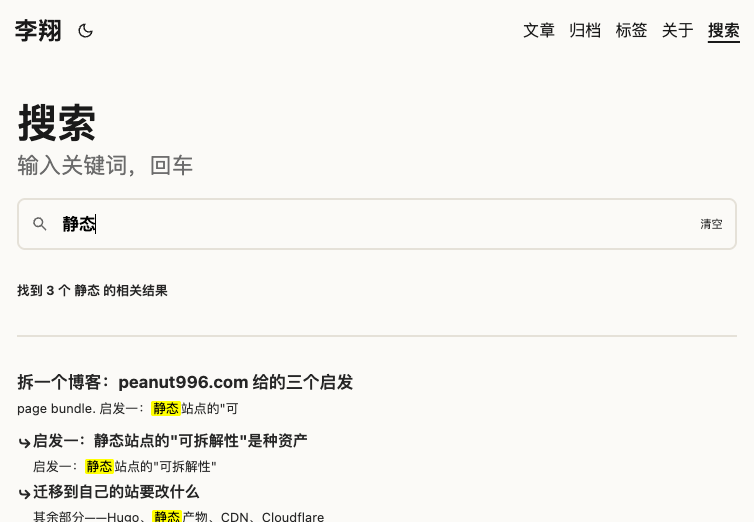
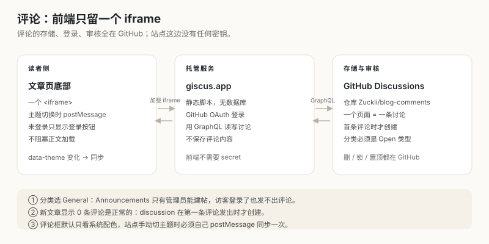
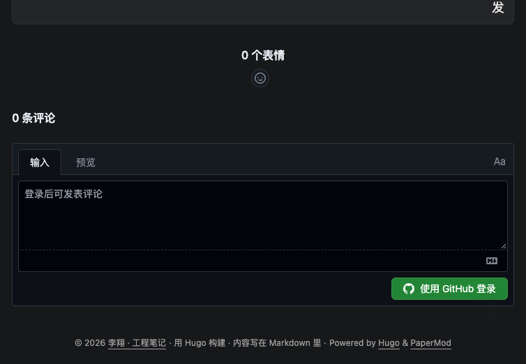
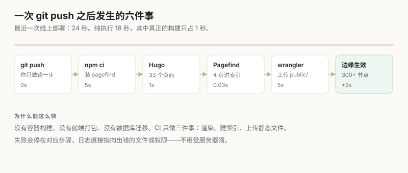

11 月 2 日晚上，这个站还是一个空目录。第二天傍晚，它有了几篇文章、能用的站内搜索、会跟着主题变色的评论区，以及一条 `git push` 之后 24 秒自动上线的流水线。

这篇文章不打算重复官方文档里的「五分钟建站」。我想把整个过程拆成三层：**为什么这么选、怎么落地、哪里踩了坑**。尤其是最后一部分——那些文档不会写、但会让人卡住半小时的地方。

> **2026-11 更新**：主站已迁到 [zuckli.github.io](https://zuckli.github.io)（GitHub Pages，仓库公开后免费），`workers.dev` 那份降级为同一次构建的镜像。本文里的线上地址和 workflow 片段保留事发当时的样子。

写这篇文章时的状态：

| 指标 | 数值 |
| --- | --- |
| 文章 | 5 篇（含本文） |
| 生成的 HTML | 38 个 |
| 完整产物 | 1.5 MB |
| 本地完整构建 | 1.4 秒 |
| CI 从 push 到上线 | 24 秒（纯执行 18 秒） |
| 首字节（本机三次） | 322–409 ms |
| 每月费用 | 0 元（workers.dev 子域） |
| 提交 | 13 次（不含本文），其中 4 次 CI 失败 |

那 4 次失败全部来自同一个原因：Cloudflare token 的权限。后面会详细讲。

## 一、先定约束，再选工具

大多数建站文章从「用什么框架」开始。我觉得顺序反了。应该先回答：**什么东西是我不能接受的**。

我给自己的约束只有三条：

1. **内容必须是纯文本**。十年后随便哪个编辑器都能打开，不依赖某个平台的导出功能。
2. **发布只能有一个动作**。不是「打开后台 → 新建 → 复制 → 粘贴 → 调格式 → 点发布」。
3. **不能有数据库**。没有要备份、要升级、要打补丁、要被扫描的东西。

这三条一写下来，选型其实已经完成大半：

| 方案 | 优点 | 为什么没选 |
| --- | --- | --- |
| WordPress | 生态最全，后台熟悉 | 需要 PHP + MySQL，插件要更新，是持续被扫描的目标 |
| Hexo | 纯静态，主题多 | 依赖 Node 工具链，构建慢一个量级，改模板要读 JS |
| Next.js + Vercel | 想加什么都能加 | 纯内容站不需要运行时；依赖升级会比写作更频繁 |
| Hugo + Workers | 单二进制、毫秒构建、免费托管 | 要接受「没有后台」，评论得寄存在 GitHub |

最后的组合是 **Hugo + PaperMod + Pagefind + Giscus + Cloudflare Workers**。

不是因为这套最强，而是因为它的**失败模式最轻**：构建失败看得见；部署失败能回滚；最坏的情况是把 `public/` 拷到任何一台静态服务器上，内容一个字都不会丢。

## 二、最后长成这样



*图 1：四层结构。层与层之间只通过「文件」耦合，没有 API 契约，也没有常驻进程。*

四层各自的职责很窄：

- **写作层**：Obsidian 写 Markdown，图片和正文放在同一个文件夹。
- **构建层**：Hugo 把 Markdown 渲染成 HTML，Pagefind 顺手生成搜索索引。
- **分发层**：Cloudflare Workers 把 `public/` 发到边缘节点。
- **互动层**：Giscus 把评论寄存到 GitHub Discussions，KaTeX 按页加载公式。

这种结构的价值不在「优雅」，在**排障**：文章不显示，查内容层；样式不对，查构建层；打不开，查分发层；评论不加载，查互动层。四层不会同时坏。

右侧的「控制面」是 Git。内容、配置、主题版本、部署历史全在提交里。回滚不是登录服务器改文件，而是 `git revert` 一次，再让它重新部署。

## 三、从空目录到第一篇文章

脚手架只需要几行命令：

```bash
hugo new site blog && cd blog
git init
git submodule add https://github.com/adityatelange/hugo-PaperMod themes/PaperMod
npm i -D pagefind wrangler
hugo new content posts/hello-world/index.md
```

配置只留真正会改的部分：

```toml
baseURL = "https://lixiang-blog.lixiang22.workers.dev/"
title = "李翔 · 工程笔记"
theme = "PaperMod"
hasCJKLanguage = true

# Obsidian 的模板目录不参与构建
ignoreFiles = ["content/_templates/.*"]

[markup.goldmark.renderer]
  # 允许在 Markdown 里写少量 HTML（首页头像、折叠块）
  unsafe = true

[params]
  ShowToc = true
  ShowCodeCopyButtons = true
  ShowReadingTime = true
```

有一个顺序很重要：**先读主题，再写配置**。PaperMod 的大版本会重排模板目录和参数名，凭记忆写 `params` 大概率白改一轮。我做的第一件事是 `ls themes/PaperMod/layouts` 和读它的 `theme.toml`，确认它要求 Hugo ≥ 0.158，然后把 CI 里的版本钉死在 `0.169.0`。

主题用 git submodule 而不是复制进仓库，是为了让「升级」成为一个显式动作：不跑 `git submodule update --remote`，它就不会悄悄变。

## 四、内容层：一篇文章就是一个文件夹

```text
content/
└── posts/
    ├── _index.md
    ├── hello-world/
    │   ├── index.md        # 正文
    │   └── cover.png       # 这篇的图，跟正文放一起
    └── building-personal-space/
        ├── index.md
        ├── cover.png
        └── fig-architecture.svg
```

这是 Hugo 的 page bundle。好处很实际：删文章时图片跟着删，不会留下孤儿文件；不用维护图床；图片走同一条部署路径，不会出现「图挂了但站还在」。

把 `content/` 直接当 Obsidian vault 用，写作体验就更顺了——在 Obsidian 里按 `Cmd+S`，浏览器里的 `hugo server` 自动刷新。

但这里踩了第一个坑。

### 坑 1：模板目录让整站构建失败

我在 vault 里放了一个 `content/_templates/post.md`，里面是 Obsidian 的模板占位符：

```markdown
---
title: "{{title}}"
date: {{date:YYYY-MM-DD}}T{{time:HH:mm:ss}}+08:00
---
```

Hugo 会把它当成 Go template 解析，在 assemble 阶段直接报错。更麻烦的是，构建失败后 `public/` 里只剩下静态资源，**0 个 HTML**。

修复是在配置里明确忽略：

```toml
ignoreFiles = ["content/_templates/.*"]
```

这里还有一个容易骗人的细节：如果你用 `hugo --quiet | tail` 看日志，命令的退出码是 `tail` 的，不是 Hugo 的。**不要只看 `$?`，要数页面**：

```bash
find public -name '*.html' | wc -l
```

这次是 38（以后每加一篇文章都会变）。这个数字比任何「Build successful」都可靠。

## 五、搜索：索引也是构建产物

静态站做搜索，传统做法是 Algolia 之类的第三方服务。Pagefind 换了个思路：**在构建完成后扫描生成的 HTML，把索引做成静态文件**。



*图 2：索引在 CI 里生成，跟 HTML 一起上传；搜索请求不出网。*

构建脚本里这一行是关键：

```json
"build": "hugo --gc --minify --cleanDestinationDir --environment production --baseURL \"${HUGO_BASEURL:-http://localhost:4321/}\" && pagefind --site public --glob \"{posts/*/index.html,about/index.html}\""
```

用 `--glob` 而不是 `--root-selector`，是因为后者会把页面的 `<h1>` 一起切掉——索引里没有标题，搜索结果就会渲染成一排 `undefined`。这个 bug 很隐蔽：搜索「静态」明明有结果，但每条都没有名字。

还有一个更细的问题：PaperMod 会在每个标题里注入一个字面量 `#` 锚点。如果不管，搜索结果的子标题末尾会带一个 `#`。处理方式是覆盖主题的 `anchored_headings.html`，给锚点加 `data-pagefind-ignore`：

```html
<a hidden class="anchor" aria-hidden="true" data-pagefind-ignore href="#...">#</a>
```

现在搜「静态」，有结果、标题正常、关键词高亮：



*图 3：搜索页。索引 656 KB，`pagefind.js` 46 KB，查询时只加载命中的分片。*

一个使用上的注意：`npm run dev` 不跑 Pagefind，本地搜索框是空的。要验证搜索，得用 `npm run preview`——它会完整构建后起一个静态服务器。

## 六、评论：把社区寄存到 GitHub

评论是最容易腐烂的一环。之前拆 [peanut996.com](https://peanut996.com) 时，我发现它用的 Gitalk 把 `clientSecret` 明文写在前端页面里。那是 2020 年 OAuth 变更留下的历史包袱，能跑，但不该再复制。

Giscus 解决的是同一个问题，但权限模型干净得多：它走 GitHub App，前端只有 `repo` / `repoID` / `categoryID`，**没有任何 secret**。



*图 4：评论的存储、登录、审核都在 GitHub；站点只负责嵌入。*

创建过程：

```bash
gh repo create blog-comments --public
gh api -X PATCH repos/Zuckli/blog-comments -f has_discussions=true
gh api graphql -f query='{repository(owner:"Zuckli",name:"blog-comments"){id discussionCategories(first:20){nodes{id name}}}}'
```

拿到 id 后写进 `hugo.toml`：

```toml
[params.comments.giscus]
  repo = "Zuckli/blog-comments"
  repoID = "R_kgDOVhOBJw"
  category = "General"
  categoryID = "DIC_kwDOVhOBJ84DKSG9"
  mapping = "pathname"
  lang = "zh-CN"
```

### 坑 2：分类选错，登录了也发不出评论

GitHub Discussions 的分类有两种类型：`Announcements` 只有管理员能建帖，`General` / `Ideas` 是开放类型。如果评论分类选了前者，访客登录 GitHub 之后仍然看不到输入框——这不是 giscus 坏了，是权限模型不允许。

### 坑 3：「Discussion not found」不是故障

新文章一开始显示「0 条评论」，调 giscus API 会返回 `Discussion not found`。这是正常的：giscus 按需创建 discussion，**第一条评论发出时才建**。不要为了「修」它去手动建一条空 discussion。

### 坑 4：评论框不会自动跟随站点主题

`preferred_color_scheme` 只读系统配色，站点右上角的手动切换它感知不到。解决办法是监听 `data-theme`，给 iframe 发消息：

```js
iframe.contentWindow.postMessage(
  { giscus: { setConfig: { theme: isDark() ? "dark" : "light" } } },
  "https://giscus.app"
);
```

但要注意：只在 iframe 就绪时强制同步一次，之后靠 `data-theme` 变化触发。否则两条路径会互相触发，形成回环。

现在文章底部的评论区是这样：



*图 5：未登录状态。访客需要 GitHub 账号，评论内容就是对应仓库里的 discussion。*

## 七、部署：把 public/ 交给边缘

Cloudflare Workers 现在支持纯静态资源。配置只有几行：

```jsonc
{
  "name": "lixiang-blog",
  "compatibility_date": "2026-10-01",
  "assets": {
    "directory": "./public",
    "not_found_handling": "404-page"
  }
}
```

`404-page` 让平台在找不到路径时返回站点自己的 `404.html`，而不是 Cloudflare 的默认错误页。

缓存策略写在 `static/_headers` 里：

```text
/assets/*
  Cache-Control: public, max-age=31536000, immutable

/pagefind/*
  Cache-Control: public, max-age=604800

/*
  X-Content-Type-Options: nosniff
  Referrer-Policy: strict-origin-when-cross-origin
  X-Frame-Options: SAMEORIGIN
```

带指纹的 `/assets/*` 可以一年不变；Pagefind 索引一周；HTML 保持 `max-age=0, must-revalidate`，这样改完文章刷新就能看到。

### 坑 5：`--dry-run` 通过，不等于能部署

第一次部署前，`wrangler deploy --dry-run` 会告诉你「Read N files from the assets directory」，这只验证配置，不验证账号。

新账号如果没有注册 `workers.dev` 子域，真部署会直接失败。注册之后证书签发还要几分钟，这段时间所有客户端都会报 TLS 握手失败——**容易被误判成「被墙」或「TLS 配错了」**。正确的做法是轮询到 200 再下结论。

### 坑 6：用 `python -m http.server` 验 404，是假阳性

`python -m http.server` 会返回它自己的 404 页面，看起来「站点 404 正常」，其实你验的是 Python 的行为。要验真实托管配置，用 `wrangler dev`。

## 八、CI：把发布压缩成一个 push

工作流只做这几件事：checkout（含 submodule）、装 Hugo、装 Node、构建、部署。

```yaml
- uses: actions/checkout@v5
  with:
    submodules: recursive
    fetch-depth: 0

- uses: peaceiris/actions-hugo@v3
  with:
    hugo-version: "0.169.0"
    extended: true

- run: npm ci

- run: npm run build
  env:
    HUGO_BASEURL: ${{ vars.SITE_URL || 'https://lixiang-blog.lixiang22.workers.dev/' }}

- uses: cloudflare/wrangler-action@v3
  with:
    apiToken: ${{ secrets.CLOUDFLARE_API_TOKEN }}
    accountId: ${{ secrets.CLOUDFLARE_ACCOUNT_ID }}
    command: deploy
```



*图 6：一次 push 之后的六步。最近一次 24 秒，纯执行 18 秒。*

### 坑 7：`baseURL` 用相对路径，会让 minify 直接失败

PaperMod 会输出 `BreadcrumbList` 的 JSON-LD。如果构建时传 `--baseURL "/"`，首页那条面包屑的路径只剩一段，模板拼出来的 JSON 少一个逗号——**单个页面是坏的，`--minify` 会中断整个构建**，而且报错指向临时文件，不指向你的文章。

所以 CI 里必须给绝对地址。`vars.SITE_URL` 没配时，用写死的线上地址兜底，别让 canonical 变成 localhost。

每次构建后我用 `json.loads` 把所有 `ld+json` 过一遍，0 失败才算过。

### 坑 8：token「有效」和 token「有权限」是两件事

这是这次唯一让我连续失败 4 次的问题。

Cloudflare 的 `/user/tokens/verify` 返回 `active`，只能证明 token 存在，不能证明它有 `Workers Scripts:Edit`。CI 会在最后一步才暴露：

```text
A request to the Cloudflare API (/accounts/***/workers/services/lixiang-blog) failed.
Authentication error [code: 10000]
```

最省时间的处理不是反复试权限，而是用 Cloudflare 的 **Edit Cloudflare Workers** 模板重建一个 token，然后把 secret 名写对：必须是 `CLOUDFLARE_API_TOKEN`。`CFUT_` 开头的那串是 token ID，不是 token 本体。

### 坑 9：`npm ci` 报 `Invalid Version:`

lockfile 里如果出现没有 `version` 的可选平台包（常见于代理或私有 registry 给 `pagefind` 的 linux-arm64 包写坏了），`npm ci` 会直接失败。用公共源重生成：

```bash
npm install --package-lock-only --registry=https://registry.npmjs.org/
```

然后检查所有 `resolved` 主机都是 `registry.npmjs.org`，否则 CI 拉不到你本地的内网源。

## 九、十一个坑的清单

把上面散落的和几个没展开的放在一起，方便下次照着排：

| 现象 | 真正的原因 | 处理 |
| --- | --- | --- |
| Hugo 构建报模板错误，`public/` 里 0 个 HTML | `_templates` 里的占位符被当 Go template | 用 `ignoreFiles` 忽略模板目录 |
| 日志「成功」但线上没更新 | 管道让 `tail` 的退出码顶替了 Hugo 的 | 数生成的 HTML 文件数 |
| JSON-LD 非法，`--minify` 失败 | `baseURL` 传了 `/` | 用绝对地址 |
| 搜索结果标题是 `undefined` | `--root-selector` 切掉了 `<h1>` | 改用 `--glob` |
| 搜索结果末尾多个 `#` | 主题注入的锚点被索引 | 锚点加 `data-pagefind-ignore` |
| 登录了也发不出评论 | 分类是 `Announcements` | 换成 `General` 等 Open 类型 |
| giscus 返回 `Discussion not found` | discussion 首条评论才创建 | 不是 bug，别修 |
| 评论框不跟随手动主题 | `preferred_color_scheme` 只读系统配色 | `postMessage` 同步一次 |
| CI 报 `Authentication error [code: 10000]` | token 缺 `Workers Scripts:Edit` | 用模板重建 token |
| 首次部署 TLS 握手失败 | 新 workers.dev 子域证书还在签发 | 等几分钟，轮询到 200 |
| `npm ci` 报 `Invalid Version:` | lockfile 里有空 version 的包 | 用公共 registry 重生成 |

还有两个不在这张表里、但值得单独记的：

- **推 `.github/workflows` 需要 token 的 `workflow` scope**。只有 `repo` 时 push 会被拒，`gh auth refresh -h github.com -s workflow` 补上。
- **首页头像的 `float` 在 PaperMod 里不生效**。`.entry-content` 是 `display:-webkit-box`，并排布局要用 `display:grid`，窄屏再退回单列。

## 十、验收：六条硬标准

`curl` 返回 200 只证明文件存在，不证明页面是对的。每次改模板，我会重跑这六条：

1. **构建产物**：38 个 HTML；Pagefind 输出 `Indexed 5 pages`、约 3500 words，无 ERROR。
2. **关键 URL**：首页、`/posts/`、一篇文章、`/search/`、`/about/`、RSS、sitemap 全部 200。
3. **浏览器**：首页文章数对；公式页 `.katex` 节点 > 0；切主题后 `data-theme` 真的翻转；搜索标题不是 `undefined`。
4. **部署配置**：`wrangler deploy --dry-run` 输出 `Read N files from the assets directory`。
5. **结构化数据**：所有 `ld+json` 用 `json.loads` 解析，0 失败。
6. **404**：`wrangler dev` 下访问不存在路径，返回站点自己的 404 页面，状态码 404。

这套清单救过我两次：一次是 JSON-LD 让构建中断，一次是搜索索引里全是 `#`。

## 十一、成本、速度与「国内能不能打开」

先把账算清楚：

| 项目 | 用量 | 费用 |
| --- | --- | --- |
| Workers 静态请求 | 不限量 | 0 |
| Workers 静态存储 | 1.5 MB | 0 |
| GitHub Actions | 每月 2000 分钟，实际每次约 24 秒 | 0 |
| `workers.dev` 子域 | 一个 | 0 |
| 自有域名 | 可选 | 约 ¥70 / 年 |

真正要花钱的只有域名。构建产物本身没有任何「按量计费」的部件。

速度方面，从我这台机器（CST）连续三次 `curl`：首字节 322 ms、324 ms、409 ms，`cf-ray` 落在东京（NRT）。这是「能打开、不算快」的水平。

需要提醒的是：**`workers.dev` 在部分国内网络（尤其移动）会被 DNS 污染或 SNI 阻断**。我这里的 200 不代表所有人都能打开。给朋友发链接前，先让对方试一次。

要更稳，有两条路：

1. 绑自有域名到 Cloudflare，延迟通常能降到 150–300 ms；
2. 整体迁到境内 OSS / COS + CDN，需要备案。

好消息是，**迁移只换上传目标**。`public/` 不变，Hugo 配置不变，部署脚本是可替换的一层。不要把这层写进业务逻辑里。

## 十二、现在的工作流

写作在 Obsidian 里，预览用：

```bash
cd ~/Sites/blog
npm run dev          # http://localhost:4321，改文件自动刷新
```

发布只有一组命令：

```bash
git add -A
git commit -m "post: 文章标题"
git push
```

push 之后 GitHub Actions 自动构建、建索引、部署，约 24 秒上线。想看进度：

```bash
gh run list --limit 3
gh run watch --exit-status
```

发布前的三条自查：

| 检查 | 说明 |
| --- | --- |
| `draft: false` | 草稿不会出现在线上，但本地 `dev` 能看到，别被本地骗了 |
| `date` 不为空 | 归档和排序依赖它 |
| 图片在文章目录里 | 只有 page bundle 内的图片才会被当作页面资源打包 |

另外两个隐式规则：

- **文件夹名就是 URL**。`content/posts/hello-world/index.md` → `/posts/hello-world/`，改名等于改链接；
- **评论按 `pathname` 映射**。改 slug 会让老评论「失联」，因为 discussion 的标题是旧路径。

回滚同样简单：`git revert` 一次，push，等 24 秒。

## 十三、我故意没修的东西

一个能长期用的系统，不是没有瑕疵，而是知道哪些瑕疵不值得修。

- **RSS 里会带上「关于」和「搜索」两个页面**。PaperMod 的 `rss.xml` 只排除 `layout: search/archives`，而搜索页用了自定义 `layout: pagefind`。要改就得覆盖整个 `rss.xml`，为两个页面抄一份模板不划算。
- **404 页面的 `<title>` 还是英文**「404 Page not found」。标题由主题的 `head.html` 生成，改它要复制两百行 partial，正文是中文就够了。
- **主题是 submodule**。升级必须显式执行，不会自动跟进。这是有意的：让「变」成为一个需要决定动作。
- **没有加访问统计**。想知道有没有人看，RSS 和评论比 PV 更有信息量；真要加，也应该是一个不阻塞渲染、不收集个人数据的小脚本。
- **没有自定义域名**。`workers.dev` 够用，等确定要长期写、并且主要读者在国内，再花那 70 块钱。

## 最后

这套东西的边界很清楚：它适合「写完就不怎么改的长文本」，不适合需要登录、实时数据、多作者后台的内容站。那些场景，框架 + 数据库确实更省事。

但如果你只是想有一个自己的地方，能写、能搜、能被人评论，而且不想每隔几个月维护一次服务器——静态站点仍然是我知道的、最不容易烂掉的答案。

建站真正贵的不是技术选型，是「决定写什么」。把发布成本压到接近零，剩下的问题才会浮出来：你究竟想留下什么。

---

*本站的技术栈、目录结构和已知取舍都写在仓库的 README 里；这篇是它的叙事版本。*