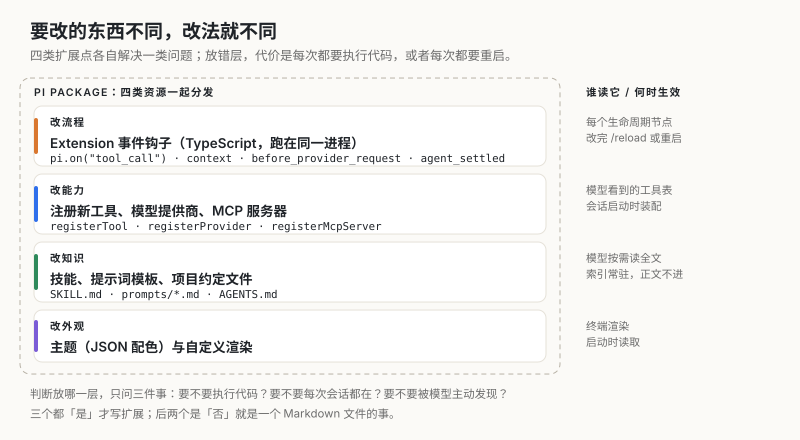
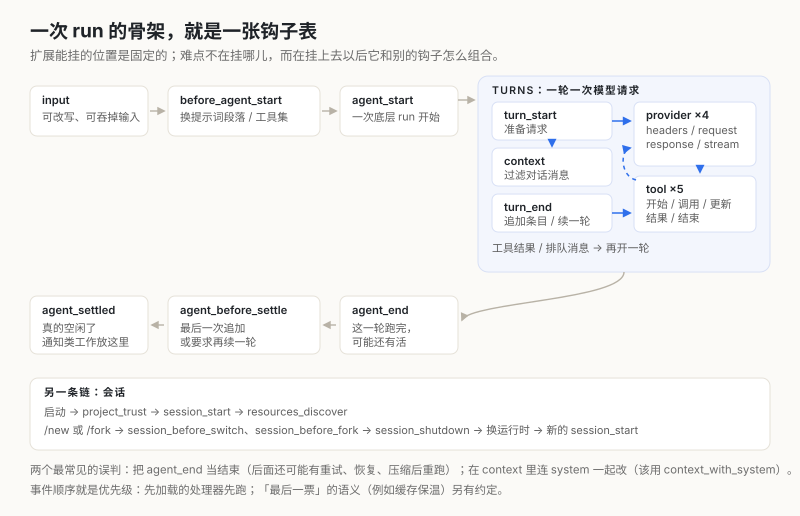
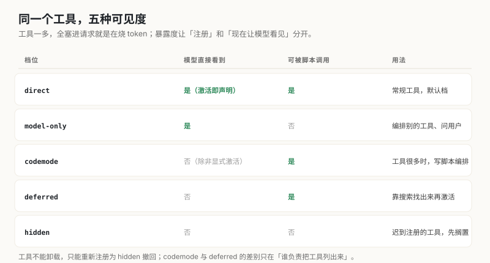
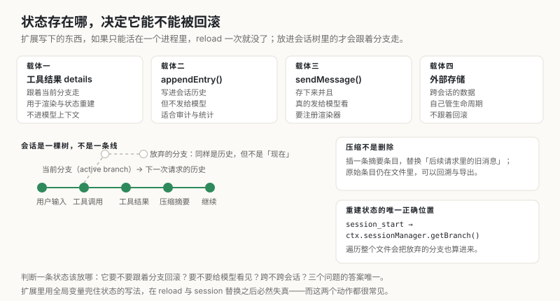

> 这是「Agent 自我进化」系列的第二篇。上一篇《记忆、技能与遗忘》拆的是 Hermes 怎么把一轮对话里的教训变成下一次的开场；这一篇讲另一层：一个 Agent 的能力边界本身，是怎么做成可替换的。

前段时间想让 `pi` 在我自己的 LiteLLM 网关上跑得更省一点。DeepSeek 的模型有前缀缓存，命中率和上下文安排强相关——工具描述放在哪个位置、什么时候清空历史、压缩之后缓存还剩多少，都会影响账单。我想要的是：每次请求前能看到缓存命中的统计，并且能在会话空闲时主动"保温"一次。

这件事有三种干法。改 Pi 的源码，然后在每次升级后重新打一遍补丁；在模型网关那边做一层代理，绕过 agent；或者，写一个扩展，挂到 Pi 自己的事件上。我选了第三种——本机现在装着的 `pi-deepseek-cache` 就是它，1,591 行 TypeScript，挂了 8 个事件钩子，另外注册了 4 个命令（`/cache-stats`、`/cache-graph`、`/cache-reset`、`/cache-warm`）。

这个选择背后是 Pi 对"扩展"的整套判断：**不是一个插件系统，而是四类扩展点，加上一张固定的生命周期钩子表**。这篇文章拆这四层各自解决什么问题，以及这套设计明确付出的代价。

## 四种改法，对应四类扩展点



*图 1：放错层的代价很具体——本该是 Markdown 的东西写成扩展，就变成每次都要执行代码。*

| 想改什么 | 用什么 | 例子 |
| --- | --- | --- |
| 流程（拦一次调用、改一次请求、加一句提示） | Extension 事件钩子 | `pi.on("tool_call")`、`before_provider_request` |
| 能力（多一个动作、多一个模型源、多一个外部系统） | 注册接口 | `registerTool`、`registerProvider`、`registerMcpServer` |
| 知识（这类任务该怎么做、这个项目有什么约定） | 文件 | `SKILL.md`、`prompts/*.md`、`AGENTS.md` |
| 外观（颜色、状态栏、渲染） | 主题与渲染器 | `themes/*.json`、`registerToolRenderer` |

判断一个需求该落在哪一层，只问三个问题：

1. **要不要执行代码？** 要，就只能是扩展（技能里也能带脚本，但脚本由模型按指令调用，不由 Pi 调度）。
2. **要不要每次会话都在？** 要，就写进常驻资源，而不是要在某个时机才生效的钩子。
3. **要不要被模型主动发现？** 要，就必须让它出现在系统提示的索引里——技能的 `description`、工具的描述，都属于这一类。

三个都答"是"，才值得写扩展。像我那个缓存统计的想法，它要执行代码（算命中率）、要在每个请求前生效（钩子）、但不需要被模型发现（人看的东西），所以它是"扩展 + 命令"，而不是工具。

反例很常见：把"项目用 pnpm 而不是 npm"写成扩展去拦截命令。那是一个 `AGENTS.md` 里的一句话，写成扩展既慢又不可移植——项目换台机器，代码还得跟过去。

## 钩子表：一次 run 里可以插入的固定位置



*图 2：外层是一次 run，内层是 turn 循环；扩展能挂的位置是封闭集合，不能自己发明。*

一次 run 的结构是这样的：输入进来（`input`），准备开跑（`before_agent_start`），底层 agent 开始（`agent_start`），然后进入 turn 循环——每个 turn 发一次模型请求、执行返回的工具调用，`turn_end` 之后再判断要不要再来一轮。跑完之后，还有 `agent_before_settle`（可以追加内容或要求再续一次）和 `agent_settled`（真的空闲了）。

模型请求内部还有四个 provider 钩子，工具执行内部有五个工具钩子。这些加起来就是扩展能碰的全部位置。

事件本身不难理解，难的是**同一个位置的多个扩展怎么组合**。Pi 把这件事写成五种语义，扩展作者必须知道自己写的是哪一种：

| 语义 | 行为 | 典型场景 |
| --- | --- | --- |
| 通知 | 返回值被忽略，只能观察 | 打点、日志、统计 |
| 原地修改 | 后面的处理器看到改动 | 改请求头、改系统提示选项、改工具入参 |
| 链式转换 | 后面的处理器收到前一个的返回值 | `context`、`tool_result`、`message_end` |
| 闸门 | 拦下就结束，不再走默认路径 | 拦危险工具调用、接管用户 shell 命令 |
| 边界动作 | 每次看到"到目前为止"的提议，可以追加或要求续一轮 | `turn_end`、`agent_before_settle` |

再加一条：`cache_warming_decision` 这种"最后一票"的语义——最后一个返回动作的处理器赢。这五种语义没有统一成一种，我认为是对的：想用一套返回值约定同时表达"我改数据"和"我拒绝执行"，最后一定会出现返回 `false` 到底是"没改"还是"不许"的歧义。

三个最容易写错的地方，都是时序问题：

**`agent_end` 不是结束。** 它后面可能还有重试、错误恢复、压缩后重跑、排队消息。真正"没事干了"的信号是 `agent_settled`。一个在 `agent_end` 里做通知的扩展，会收到好几次；一个在 `agent_end` 里做清理的扩展，会把还在用的资源关掉。

**`context` 和 `context_with_system` 是两件事。** 前者只改对话消息，Pi 用完会恢复；后者连系统消息一起改，只能有一个，而且必须把系统消息留在第 0 位。想把 system prompt 一起过滤，用错了就是静默不生效。

**处理器顺序就是优先级。** 按加载顺序执行，先加载的先跑。这意味着"谁先注册谁先改数据"——两个扩展都改同一段上下文时，后装的看到的是前一个改过的版本。要写"最后说了算"的语义（比如缓存保温决策），得靠约定，不能靠自己猜。

回到那个缓存扩展。它挂的 8 个钩子分布在三类位置上：`message_end` 和 `context` 做统计与上下文整理，`before_provider_request` 改请求，`cache_warming_decision` 做保温决策，剩下四个是会话生命周期（`session_start`、`session_before_switch`、`session_before_compact`、`session_shutdown`）。一个 1,591 行的扩展，本质是"把前缀缓存这一横切关注点，散点挂到它能看见的每个时机上"。这也是扩展适合的形态：**横切的东西做扩展，纵向的东西做工具**。

## 工具：声明、暴露度，以及"谁能看见"



*图 3：注册和"现在让模型看见"被拆成两件事，这是工具数量上去以后唯一的出路。*

一个工具是四件套：名字、给模型看的描述、参数 schema（TypeBox）、`execute()` 函数。返回值里 `content` 给模型看，`details` 给渲染和状态重建用——`details` 不进模型上下文，这一点常被忽略，把大对象塞进 `content` 会直接烧掉预算。

错误语义分三种，各有用途：

- `throw` → 得到一个失败的 tool result，模型看到错误；
- 返回对象但标 `isError: true` → 模型看到错误，**同时**脚本还能拿到 `structuredContent` 里的数据；
- 返回 `terminate: true` → 这一批工具都同意时，跳过 agent 的自动后续。

第三种很少见但很关键：一次批量调用里，如果所有工具都表示"不需要再问了"，agent 就不再多发一轮请求。省的是真金白银的一轮。

真正有意思的是 `exposure`。默认的 `direct` 是"注册即声明给模型"，但工具一多，全塞进请求就是灾难——一个 MCP 服务器能带来几十个工具，每个都带描述。于是有了五档：

- `direct`：模型看得到，也能被其他工具调；
- `model-only`：模型看得到，但只能由别的工具调（编排类工具用它，比如"问用户"）；
- `codemode`：不声明给模型，但注册了就能被脚本调；`codemode` 工具负责把它们列出来，模型写一段脚本一次编排多个调用；
- `deferred`：也不声明，但 `codemode` 不列它，靠 `tool_search` 找出来再激活；
- `hidden`：注册了但谁都够不到。工具不能卸载，撤回一个工具的唯一办法就是重新注册为 `hidden`。

`codemode` 这一档的动机值得单说。工具从 10 个涨到 100 个时，模型面对的不是"能力更强"，而是"读不完的说明书"。换成"给我一个能调所有工具的脚本环境"，请求里只留一个工具的描述，剩下的靠模型按需搜索、按需组合。这是把"工具选择"从提示工程挪到了程序里。

配套的还有几个容易漏的细节：

- 同一个 assistant 消息里的多个工具调用**可以并行执行**，所以工具之间不能假设兄弟调用的顺序，也不能假设对方的结果已经存在；
- 会写文件的工具要用 `withFileMutationQueue()` 把读-改-写整段包起来，否则两个并发调用会互相覆盖；
- 工具可以嵌套调用别的工具（`ctx.executeTool`），嵌套调用也走参数校验和那几个钩子，但不会在对话记录里多出条目——结果只回到调用方；
- `annotations`（`readOnlyHint`、`destructiveHint`、`openWorldHint`）是给权限类扩展用的。一个统一的确认闸门可以只靠注解决定"这个调用要不要问人"，不必认识每个工具：

```typescript
pi.on("tool_call", async (event, ctx) => {
  const hints = pi.getAllTools().find((t) => t.name === event.toolName)?.annotations;
  const needsApproval =
    hints?.destructiveHint === true ||
    (!hints?.readOnlyHint && (hints?.destructiveHint ?? true));
  if (needsApproval && !(await ctx.ui.confirm("Allow tool call?", event.toolName))) {
    return { block: true, reason: `${event.toolName} was not approved` };
  }
});
```

这段代码的价值不在代码，在契约：**注解是声明式的意图，权限扩展只消费意图**。没有它，每加一个工具就要改一遍权限逻辑。

## 状态：可回滚的进树，不可回滚的进外部



*图 4：扩展写下的东西放在哪，决定了 reload、切换会话、回滚分支之后它还在不在。*

扩展常常需要记点东西：待办列表、统计计数、上次看到哪个文件。Pi 给了四种位置，选错一个有明确的后果：

| 状态性质 | 放哪 | 后果 |
| --- | --- | --- |
| 跟着当前分支走、用于渲染 | 工具结果的 `details` | 回滚分支时一起回滚，符合直觉 |
| 要留在历史里、但不给模型看 | `pi.appendEntry()` | 审计、统计可用；不进模型上下文 |
| 要让模型也看到 | `pi.sendMessage()` | 存下来并发送，需要注册渲染器 |
| 跨会话 | 外部存储 | 自己管生命周期，不参与回滚 |

会话本身是一棵树，不是一条线。每个条目记录自己的父节点，从当前条目往回走出来的路径就是"活动分支"，也就是下一次请求的历史。从旧条目继续会长出新分支，`/fork` 和 `/clone` 会复制选中的历史到新文件，`/compact` 插一条摘要条目替换后续请求里的旧消息——**原始条目还在文件里**，只是模型看不见了。

这带来一个必须说清的重建规则：**在 `session_start` 里用 `ctx.sessionManager.getBranch()` 重建状态，不要遍历整个会话文件的条目**。文件里包含被放弃的分支，那些是"另一种可能的历史"，把它们也算进当前状态会让计数翻倍、待办复活。

我见过的最典型错误，是把状态存在模块级变量里。它在一次会话里工作得很好，然后 `/reload`（改扩展、改技能、改主题都会触发）把运行时换掉，`/new` 或 `/resume` 换会话，状态就没了或者串了。这不是扩展作者的疏忽，是设计上没给"进程内状态"任何承诺——文档写得很直白：reload 之后，`await ctx.reload()` 后面的代码属于旧运行时，不能再用它的状态。

## 知识类扩展：三个文件级别的东西

前两层都要写 TypeScript，后两层不用。这个分界很重要：**能写成文件的，就不要写成代码**。

**技能**是一个含 `SKILL.md` 的目录，可以带 `scripts/`、`references/`、`assets/`。启动时 Pi 只把每个技能的名字、描述、路径放进系统提示，正文一个字都不进；模型判断相关了才去读全文，或者由人用 `/skill:name` 强制加载（后面跟的内容会作为用户请求追加）。Frontmatter 里那句 `description` 决定了路由准不准——写成"帮助处理 PDF"就是没写，因为模型没法判断什么时候该用。

**提示词模板**是带 frontmatter 的 Markdown，文件名就是命令名：`~/.pi/agent/prompts/review.md` 就是 `/review`。它支持 `$1`、`$@`、`${1:-default}` 这些替换，且在有同名扩展命令时让位给扩展。有一个容易忽略的先后：模板展开之前，`input` 事件先看到原始输入——所以"记录用户到底敲了什么"要靠 `input`，不能靠 `before_agent_start`。

**项目约定文件**（`AGENTS.md` 之类）在项目信任之后才加载，和项目级技能、模板、主题一起。

什么时候写技能、什么时候写扩展，判断标准是"要不要 Pi 替你调度"：

| 需求 | 技能 | 扩展 |
| --- | --- | --- |
| 教模型一套流程 | ✅ 指令足够 | 也能做，但没必要 |
| 需要一个新工具 | 只能带脚本，由模型主动跑 | ✅ 注册成工具，可靠、可渲染 |
| 需要在请求前改东西 | ❌ 做不到 | ✅ 钩子 |
| 需要跨会话计数 | ❌ | ✅ 状态载体 |
| 想让人手动触发 | ✅ `/skill:name` | ✅ `registerCommand` |

## 分发：包是四类资源的容器

本机装了五个包，形态各不相同，正好能说明"包"这个抽象有多薄：

| 包 | 声明了什么 | 实际形态 |
| --- | --- | --- |
| `pi-subagents` | `extensions` + `skills` + `prompts` | 一个包长出子代理体系：2 个技能、6 个提示词模板、多个 agent 定义 |
| `pi-web-access` | `extensions` 指向 `./dist` | 只加工具，附带一个演示视频用于画廊 |
| `pi-deepseek-cache` | 单个 `./index.ts` | 1,591 行，8 个钩子，4 个命令 |
| `pi-powerline-footer` | 单个 `./index.ts` | 3,723 行，专做状态栏：`tool_result`、`user_bash`、`model_select` 等 8 个事件 |
| `@narumitw/pi-btw` | 单扩展 | 一个小工具 |

包就是目录或 npm 包，`package.json` 里的 `pi` 字段声明四类资源的路径，没有声明就按约定目录（`extensions/`、`skills/`、`prompts/`、`themes/`）自动发现。安装三种源：npm（可钉版本）、git（钉 tag 或 commit）、本地路径（直接加载，不复制）。

两条经验性规则：

**宿主提供的包必须写成 `peerDependencies` 的 `"*"`，不能进 `dependencies`。** `@earendil-works/pi-coding-agent` 这类包如果被复制一份进依赖树，ESM 里会出现两个类、两个注册表，扩展注册的东西宿主看不见——而且是静默的。Pi 会检测这个配置并给警告，但警告很容易被当成噪音。

**项目级和个人的边界靠信任。** 个人安装写进 `~/.pi/agent/settings.json`，项目安装写进 `.pi/settings.json`，后者在项目信任（`project_trust`）之后才生效。想临时试一个包，`pi -e npm:@example/pi-tools` 只对这一次调用生效，不写进配置。

## 与上一篇的对照：一个管"记得"，一个管"能换"

两篇讲的是同一件事的两面，值得并排看：

| | Hermes（记忆闭环） | Pi（扩展机制） |
| --- | --- | --- |
| 积累的是什么 | 经验：事实与流程 | 能力：工具、提供商、知识文件 |
| 谁写进去的 | Agent 自己在每轮之后复盘写入 | 人写，或包提供 |
| 怎么防膨胀 | 字符预算 + 时间衰减 + 归档 | 暴露度分级 + 包版本与信任 |
| 生效时机 | 下一次会话开场注入 | 启动装配、钩子触发、按需读取 |
| 失效方式 | 遗忘（时间）/ 被新事实覆盖 | 卸载、降级为 hidden、版本不兼容 |
| 明确不做的事 | 不改权重 | 不负责学习 |

一句话区分：Hermes 关心"下一次它还记得吗"，Pi 关心"这一层还能不能换掉"。两者不冲突，反而互补——一个自己会积累但能力固定的系统，和一个能力随便换但自己不学习的内核，拼起来才接近"能长期工作的 agent"。

这也正是我在 `agent-team-harness` 里做的事：执行交给 Pi（工具、模型、会话、扩展点都成熟了），记忆与画像那一层自己写（按任务类目组织，而不是按对话组织）。如果直接拿 Pi 的会话来当"记忆"，会同时踩两个坑：会话是树，不能当身份；上下文压缩之后，早期事实就只剩摘要。

## 这套设计的四个代价

**所有扩展跑在同一个进程里，没有沙箱。** 扩展能读提示词、工具入参、文件、凭据、会话历史，用的是 Pi 进程的操作系统权限。文档第一段就写明了这一点。这意味着"装一个来路不明的扩展"和"给这个 shell 加一段来路不明的代码"是同一件事。

**项目信任只挡项目资源。** `project_trust` 在加载项目设置与资源之前问一次，能挡住仓库里偷偷放的 `.pi/extensions`。但它挡不住你已经装在个人目录里的扩展——那些是你自己授权的。

**钩子是有顺序的、有延迟的。** 处理器按加载顺序执行；在流式事件上做慢活会拖慢整个流消费。一个在 `provider_stream_event` 里做网络请求的扩展，会让每个 token 都变慢。文档对此的说法是"通知类处理器不要在流式事件上做慢活"，但没有强制手段。

**扩展和宿主的类型是一起演进的。** 扩展 `import type { ExtensionAPI }` 就绑定了当前大版本的契约。升级 Pi 之后，扩展可能不是报错，而是某些字段没了、某个事件不发了——静默失效比崩溃更难发现。

还有一条不算代价但需要知道的：工具不能注销。要用 `hidden` 撤回，而且"撤回"只是对模型不可见，注册表里还留着。这是有意的取舍——注册表是宿主的状态，不交给扩展删。

## 三条可以搬走的设计

**扩展点按"改什么"分层，不按"谁来改"。** 流程、能力、知识、外观四类，每一类的实现语言、生效时机、分发方式都不同。混成一种"插件"，要么让纯文本的改动也去写代码，要么让代码级的需求被迫写成配置。

**每个钩子必须写明组合语义。** 通知、原地修改、链式转换、闸门、边界动作——五种而不是一种。写清楚之后，两个互不认识的扩展才能安全地挂在同一个位置上。

**状态按"能不能回滚"分载体。** 跟着分支走的放会话树，跨会话的放外部，只给渲染用的放 `details`。想省事全放内存，就在 reload 和换会话时付出代价。

要自己验证这套东西，成本很低：写一个十行的扩展（注册一个 `/hello` 命令），用 `pi --extension ./hello.ts` 起一个会话，`/hello` 一下。这一步走通，你就知道扩展是真的在进程里跑，而不是一个配置文件在生效。然后打开 `~/.pi/agent/settings.json`，看看 `packages` 那几行的来源——你装过的每一个能力，都在那几行里。

---

**上一篇**：《记忆、技能与遗忘：Agent 的自进化闭环是怎么搭起来的》讲的是积累那一半：预算、复盘、衰减。两篇合起来，是一个 Agent 能够长期工作所需的两个前提——它记得住，它换得动。