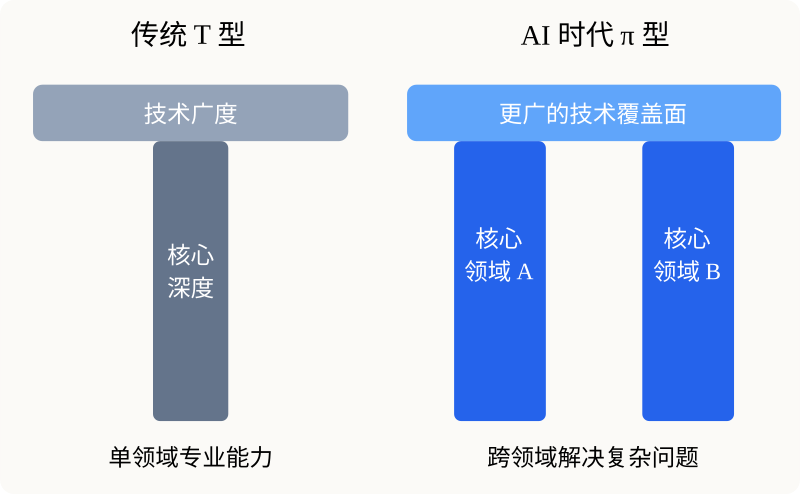

用 AI 做一个陌生技术栈的功能，起步比以前容易多了。真正考验我的是功能跑起来之后的事。接口偶尔超时，我能不能定位原因？模型推荐换一套架构，我能不能判断迁移成本，以及它解决的究竟是哪一个问题？

这改变了我分配学习时间的方式。我愿意接触更多技术，也会挑一两个领域往深处学。广度帮我看见更多解法，深度帮我判断这些解法在真实约束下能不能成立。

## 从熟记 API 到判断方案

借助 AI，我可以边查文档、边用一个陌生框架做出原型。语法和常用接口可以在需要时查。至于原型能不能上线、出了故障能不能修，我仍然要自己做判断。

| 能力 | 我怎么看它的变化 |
| --- | --- |
| 语言语法、框架 API | 熟记的收益相对下降，能读懂和改对依然重要 |
| 跨栈开发 | 起步成本降低，适合用完整项目练习 |
| 操作系统、网络、数据库等基础 | 仍是理解系统行为和排查问题的底子 |
| 需求抽象与任务拆解 | 要把目标、约束和验收条件说清楚，AI 才能沿着合适的方向实现 |
| 架构设计与技术选型 | 方案更容易拿到，取舍更需要由我判断 |
| 调试、正确性与安全性判断 | 生成的代码越多，我越依赖这些能力来验证结果 |

## 从一项专长到两项互补的专长

我用 T 型和 π 型来想这件事。T 型的横线是技术广度，竖线是一项核心专长。π 型多了一条竖线，适合描述我想在两个互相补充的领域都建立深度的情况。我会先站稳一个方向，再通过实际项目积累第二项专长。

接触一项技术时，我先给自己定一个掌握目标，再决定花多少时间。

| 层次 | 我能做到什么 |
| --- | --- |
| L1 · 认知 | 知道这项技术解决什么问题 |
| L2 · 应用 | 能查文档、借助 AI 完成开发 |
| L3 · 理解 | 能读代码、独立调试、判断方案取舍 |
| L4 · 精通 | 能做架构设计、性能优化和复杂故障排查 |
| L5 · 创新 | 能针对现有方案的局限提出并验证新做法 |

对外围技术，我通常以 L2 到 L3 为目标。对核心方向，我希望能走到 L4，在具体问题上尝试做到 L5。

## 深挖原理，用项目拓宽视野

### 深挖能反复用到的知识

我会优先学生命周期长、能迁移到不同项目的知识，例如计算机体系结构、操作系统、网络、并发与异步编程、数据库、分布式系统和性能分析。如果核心方向跟模型有关，机器学习与深度学习的原理也在这一层。

拿高并发服务来说，AI 可以很快写出一个版本。如果加机器后吞吐量几乎没变，我会先测出时间花在哪里。锁等待、数据库连接池和下游响应时间，指向的排查方向各不相同。遇到死锁或内存持续增长，我也需要理解资源如何竞争、对象为什么还被引用，才能设计实验验证猜测。这些问题换个框架还会遇到。

### 通过完整项目拓宽技术栈

前端、后端、Docker、Kubernetes、CI/CD、云服务、消息队列、可观测性和 Agent 框架，我更愿意放到项目里学。我会弄清工具适合什么场景、有什么边界、怎么跟其他组件配合。比如第一次接入消息队列，我会关心消费失败后怎么重试，以及重复消费会怎样影响业务。带着这些问题查 API，学到的东西更容易留下来。

如果云原生就是我的主攻方向，Kubernetes 的调度、网络和资源管理就值得单独深挖。哪项技术算核心，取决于我要解决什么问题。

## 用 60/30/10 分配学习时间

我会先按下面的比例试一段时间，再根据手上的项目调整。

| 时间 | 用在哪儿 |
| --- | --- |
| **60%** | 核心技术。读原理和源码、做实验、定位复杂问题、做性能优化或研究。 |
| **30%** | 技术广度。借助 AI 做跨栈项目，走完实现、部署和排障。 |
| **10%** | 前沿探索。试新工具和新架构，看看它们解决了什么问题。 |

拓宽技术栈时，我会用 Vibe Coding 加快实现，尽早接触集成问题。往深处学时，我会让 AI 帮我找源码入口、解释概念或设计实验，再自己做关键推理和技术决策，用运行结果检验判断。

## 用故障检验技术广度

假设我借助 AI 搭了一个支持多用户、并发执行、独立沙箱和资源调度的 Agent 平台。演示跑通之后，我会用几个问题检验自己学到了什么。

- 我为什么选进程、容器或虚拟机来隔离任务？不同方案有什么成本？
- 多个 Agent 同时运行时，CPU、GPU 和内存怎么分配？
- 并发任务从 10 个增加到 1000 个时，哪里会先到瓶颈？我打算测什么来验证？
- 任务超时后，占用的资源能否可靠释放？一个租户耗尽配额时，其他租户会受到什么影响？
- 如果线上突然变慢，我能否独立定位到调度、执行环境或下游依赖？哪些观测结果会让我调整现有架构？

我会挑一个问题亲手测。比如给并发任务逐步加压，同时记录排队时间、执行时间和资源利用率，再看瓶颈落在哪里。能复现、解释并验证一次故障，比多跑通几个功能更能告诉我自己学到了哪一层。

## 用下一次技术决策检验学习成果

我希望下次接手一个陌生系统时，能尽快读懂它的边界，知道哪些部分可以借助 AI 实现，哪些判断要亲自验证，也能在系统出问题时找到排查入口。对我来说，学习计划可以从手上最难解释的一个系统行为开始。从那里往下挖原理，再把原理带到下一个跨栈项目里试一遍。
